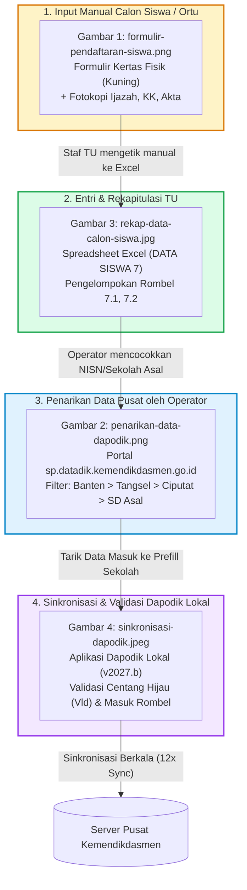
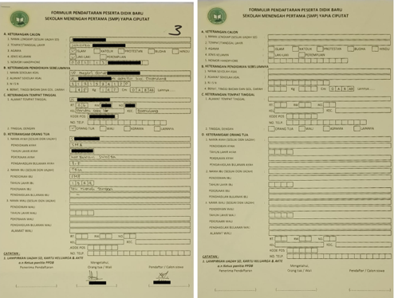
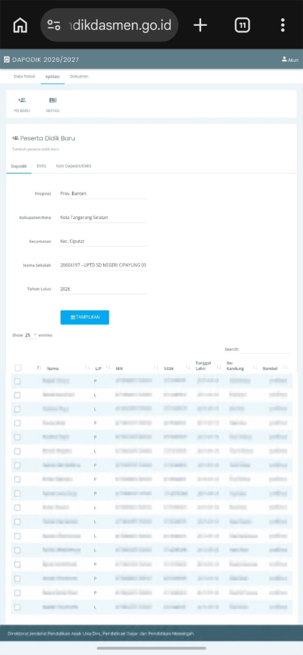
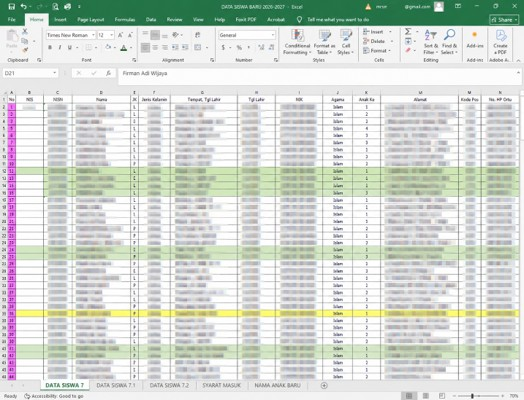
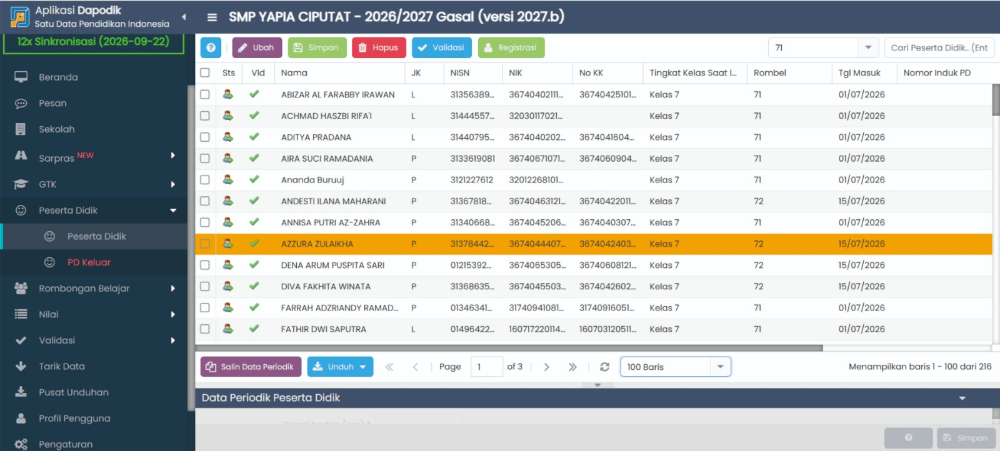

# Analisis Bukti Visual Dokumen PPDB & Alur Sinkronisasi Dapodik SMP YAPIA Ciputat

Dokumen ini memuat analisis mendalam terhadap 4 (empat) artefak visual operasional Penerimaan Peserta Didik Baru (PPDB / SPMB) di lingkungan **SMP YAPIA Ciputat, Tangerang Selatan**:
1. [`docs/formulir-pendaftaran-siswa.png`](./formulir-pendaftaran-siswa.png) — *Formulir Fisik Kertas Pendaftaran Calon Siswa Baru*
2. [`docs/penarikan-data-dapodik.png`](./penarikan-data-dapodik.png) — *Portal Pusat Manajemen Dapodik Kemendikdasmen (`sp.datadik.kemendikdasmen.go.id`)*
3. [`docs/rekap-data-calon-siswa.jpg`](./rekap-data-calon-siswa.jpg) — *Spreadsheet Master Excel Data Siswa Baru (TU & Operator)*
4. [`docs/sinkronisasi-dapodik.jpeg`](./sinkronisasi-dapodik.jpeg) — *Aplikasi Desktop Dapodik Satuan Pendidikan SMP YAPIA Ciputat (Versi 2027.b)*

---

## 1. Diagram Aliran Data Operasional (*Current State Data Lifecycle*)

Berdasarkan keempat bukti visual di atas, berikut adalah siklus hidup data (*data flow*) pendaftar di SMP YAPIA Ciputat saat ini sebelum dan sesudah digitalisasi:

---

## 2. Analisis Rinci Dokumen 1: `formulir-pendaftaran-siswa.png`
*(Formulir Fisik Kertas Pendaftaran Siswa Baru SMP YAPIA Ciputat)*

### A. Deskripsi Visual & Konteks
Gambar menampilkan dua lembar formulir pendaftaran fisik resmi berwarna kuning muda:
- **Lembar Kiri**: Contoh formulir nomor urut `3` yang telah diisi tulisan tangan oleh pendaftar, diverifikasi, serta ditandatangani oleh panitia dan orang tua.
- **Lembar Kanan**: Template blanko formulir kosong standar yang dicetak oleh yayasan/panitia PPDB.

### B. Anatomi & Struktur Data Formulir Fisik
Formulir terbagi ke dalam 4 bagian utama yang sangat terstruktur:

1. **Bagian A: Keterangan Calon**
   - `Nama Lengkap`: Sesuai ijazah SD.
   - `Tempat/Tanggal Lahir`: Tempat lahir dan tanggal lahir calon siswa.
   - `Agama`: Pilihan kotak centang (`Islam`, `Katolik`, `Protestan`, `Budha`, `Hindu`).
   - `Jenis Kelamin`: Pilihan kotak centang (`Laki-laki` / `Perempuan`).
   - `Nomor Handphone`: Kotak-kotak digit nomor telepon seluler/WhatsApp.

2. **Bagian B: Keterangan Pendidikan Sebelumnya & Fisik**
   - `Nama Sekolah Asal`: Nama SD/MI sebelumnya (contoh pada gambar: *SD Negeri Pondok Cabe Ilir...*).
   - `Alamat Sekolah Asal`: Alamat lengkap SD/MI.
   - `NISN`: 10 kotak digit angka Nomor Induk Siswa Nasional.
   - `Fisik & Kesehatan`: 
     - Berat Badan (`Kg`)
     - Tinggi Badan (`Cm`)
     - Golongan Darah (`O`, `A`, `B`, `AB`, `Lainnya`)

3. **Bagian C: Keterangan Tempat Tinggal**
   - `Alamat Jalan`: Nama jalan, nomor rumah, RT, dan RW.
   - `Kelurahan` & `Kecamatan`: Wilayah administratif domisili (pada gambar: *Kel. Pondok Cabe Ilir, Kec. Pamulang*).
   - `Kode Pos`: 5 digit kotak angka.
   - `No. Telp`: Nomor telepon rumah/kontak alternatif.
   - `Tinggal Dengan`: Pilihan radio (`Orang Tua`, `Wali`, `Asrama`, `Lainnya`).

4. **Bagian D: Keterangan Orang Tua / Wali**
   - **Data Ayah**: Nama lengkap (sesuai ijazah), Pendidikan terakhir (SMA/SMP/dst), Tahun lahir (4 kotak digit), Pekerjaan (Karyawan Swasta, dst), dan Penghasilan bulanan (misal: *3 - 5 Juta*).
   - **Data Ibu**: Nama lengkap (sesuai ijazah/akta), Pendidikan terakhir, Tahun lahir (4 kotak digit), Pekerjaan (Ibu Rumah Tangga, dst), dan Penghasilan bulanan.
   - **Data Wali**: Nama wali, Pendidikan, Tahun lahir, Pekerjaan, Penghasilan, dan Alamat lengkap wali (diisi bila tinggal bersama wali).

5. **Bagian Pengesahan & Legalitas**
   - **Catatan Lampiran Wajib**: *Lampirkan Ijazah SD, Kartu Keluarga & Akte*.
   - **Kolom Tanda Tangan**:
     - `a.n Ketua Panitia PPDB (Penerima Pendaftaran)`
     - `Mengetahui Orang Tua / Wali`
     - `Pendaftar / Calon Siswa`

### C. Temuan Kritis & Evaluasi
- **Kelebihan**: Struktur pengelompokan data formulir fisik ini sangat rapi dan konsisten dengan kebutuhan data pokok pendidikan.
- **Kelemahan & Titik Rawan**:
  - Pengisian manual tulisan tangan sering menyebabkan salah baca angka NISN, NIK, dan tanggal lahir.
  - Belum tercantum klausul persetujuan pemrosesan data pribadi (*Consent Checkbox*) sesuai amanat **UU Perlindungan Data Pribadi No. 27/2022**.
  - Tidak ada kolom untuk mendata penerima bantuan afirmasi (KIP / PIP / SKTM) secara formal, sehingga penanganan subsidi infak dan kuota afirmasi rawan tercecer.

---

## 3. Analisis Rinci Dokumen 2: `penarikan-data-dapodik.png`
*(Portal Manajemen Dapodik Pusat Kemendikdasmen - Modul Tarik PD Baru)*

### A. Deskripsi Visual & Konteks
Gambar menampilkan layar ponsel/browser operator sekolah yang sedang membuka portal resmi **Kementerian Pendidikan Dasar dan Menengah**:
- **Alamat Portal**: `sp.datadik.kemendikdasmen.go.id`
- **Tahun Ajaran Aktif**: `DAPODIK 2026/2027`
- **Modul Aktif**: `Aplikasi` ➔ `Peserta Didik Baru (PD BARU)`
- **Kategori Sumber Siswa**: Tab `Dapodik` (siswa lulusan SD/MI yang terdaftar di sistem Dapodik pusat).

### B. Hierarki Filter Penarikan Siswa (*Cascading Search Mechanism*)
Portal Kemendikdasmen **tidak menyediakan fitur pencarian nama siswa secara global**. Untuk menarik data satu orang siswa lulusan SD ke SMP, Operator Dapodik (Bpk. Ruslan) wajib memilih hierarki filter berikut:
1. `Propinsi`: **Prov. Banten**
2. `Kabupaten/Kota`: **Kota Tangerang Selatan**
3. `Kecamatan`: **Kec. Ciputat**
4. `Nama Sekolah`: **20604197 - UPTD SD NEGERI CIPAYUNG 03** (Kombinasi NPSN 8 digit dan Nama Sekolah Resmi)
5. `Tahun Lulus`: **2026**
6. Tombol Aksi: **[ TAMPILKAN ]**

### C. Struktur Data Hasil Penarikan Siswa Lulusan SD
Setelah tombol *Tampilkan* ditekan, sistem memunculkan daftar seluruh alumni lulusan SD tersebut dengan kolom:
- Checkbox pilihan penarikan siswa
- `Nama` Calon Siswa
- `L/P` (Jenis Kelamin)
- `NIK` (Nomor Induk Kependudukan 16 digit)
- `NISN` (Nomor Induk Siswa Nasional 10 digit)
- `Tanggal Lahir` (Format ISO: `YYYY-MM-DD`)
- `Ibu Kandung` (*Field kunci validasi Dapodik untuk mencocokkan data Dukcapil*)
- `Rombel` (Rombongan belajar kelas 6 SD asal)

### D. Implikasi Langsung bagi Perancangan Sistem PPDB Online (SIPMB)
> [!IMPORTANT]
> **Mengapa Fitur "Ekspor Dapodik" di Dashboard Admin Sangat Dibutuhkan:**
> Screenshot ini membuktikan bahwa operator sekolah sangat tersiksa jika data pendaftar baru hanya disajikan dalam daftar acak. Operator harus mencari satu per satu berdasarkan **Kecamatan dan Sekolah Asal SD**.
> 
> Oleh karena itu, fitur **Ekspor Dapodik di SIPMB SMP YAPIA** harus mengelompokkan data pendaftar otomatis berdasarkan **Kecamatan & Nama Sekolah Asal SD (disertai NPSN)** agar operator tinggal membuka portal `sp.datadik`, memilih sekolah asal yang sama, dan langsung mencentang nama-nama siswa yang mendaftar.

---

## 4. Analisis Rinci Dokumen 3: `rekap-data-calon-siswa.jpg`
*(Spreadsheet Master Excel Data Siswa Baru 2026-2027)*

### A. Deskripsi Visual & Konteks
Gambar menampilkan aplikasi Microsoft Excel yang membuka lembar kerja sekolah berjudul:
`DATA SISWA BARU 2026-2027 - Excel`
File ini dikelola oleh Staf Administrasi Tata Usaha (Sdri. Aila Syifa) bersama Operator Sekolah untuk merekap seluruh formulir fisik yang masuk.

### B. Struktur Tab Sheet & Pengelompokan Data
Di bagian bawah terlihat tab-tab lembar kerja:
1. `DATA SISWA 7` *(Sheet aktif utama - seluruh pendaftar kelas 7)*
2. `DATA SISWA 7.1` *(Pembagian rombongan belajar kelas 7.1)*
3. `DATA SISWA 7.2` *(Pembagian rombongan belajar kelas 7.2)*
4. `SYARAT MASUK` *(Checklist kelengkapan berkas fisik)*
5. `NAMA ANAK BARU` *(Draft pendaftar baru)*

### C. Pemetaan Kolom Data (*Field Mapping*)
Tabel rekap Excel ini memiliki 14 kolom data:

| Kolom | Nama Kolom | Deskripsi & Format Data |
| :---: | :--- | :--- |
| **A** | `No` | Nomor urut pendaftar (highlight warna ungu, terisi hingga puluhan baris) |
| **B** | `NIS` | Nomor Induk Siswa lokal internal SMP YAPIA (diisi saat resmi menjadi siswa) |
| **C** | `NISN` | Nomor Induk Siswa Nasional (10 digit numerik) |
| **D** | `Nama` | Nama lengkap siswa (contoh pada formula bar: *Firman Adi Wijaya*) |
| **E** | `JK` | Inisial Jenis Kelamin (`L` atau `P`) |
| **F** | `Jenis Kelamin` | Keterangan jenis kelamin lengkap |
| **G** | `Tempat, Tgl Lahir` | Format gabungan (*Contoh: Jakarta, 12/05/2013*) |
| **H** | `Tgl Lahir` | Format tanggal terpisah |
| **I** | `NIK` | Nomor Induk Kependudukan 16 digit siswa (dari KK/Akta) |
| **J** | `Agama` | Mayoritas terisi *Islam* |
| **K** | `Anak Ke` | Posisi urutan anak dalam keluarga (angka: `1`, `2`, `3`, `4`, dst.) |
| **L** | `Alamat` | Alamat domisili tempat tinggal siswa lengkap |
| **M** | `Kode Pos` | Kode pos 5 digit domisili |
| **N** | `No. HP Ortu` | Nomor kontak handphone / WhatsApp orang tua untuk komunikasi |

### D. Sistem Pewarnaan Baris (*Row Highlighting*)
- **Baris Hijau Muda**: Menandai siswa yang data berkas fisiknya telah lengkap dan terverifikasi di TU.
- **Baris Kuning**: Menandai siswa dengan status catatan khusus / membutuhkan observasi lanjutan / subsidi.
- **Baris Putih**: Pendaftar reguler yang masih dalam proses verifikasi.

### E. Evaluasi Kesenjangan Tata Kelola (*Gap Analysis*)
1. **Redundansi Kolom**: Terdapat kolom ganda seperti `JK` vs `Jenis Kelamin` serta `Tempat, Tgl Lahir` vs `Tgl Lahir` yang memboroskan tenaga pengetikan staf TU.
2. **Ketiadaan Enkripsi & Kontrol Hak Akses**: File Excel disimpan secara lokal di komputer TU dan rawan terhapus, tertimpa, atau bocor (terdapat data sensitif NIK dan No HP).
3. **Pencatatan Baru Teridentifikasi**: Field **`Anak Ke`** terbukti menjadi data wajib sekolah yang sebelumnya belum ada di formulir fisik, namun dibutuhkan untuk pelaporan Dapodik.

---

## 5. Analisis Rinci Dokumen 4: `sinkronisasi-dapodik.jpeg`
*(Aplikasi Dapodik Satuan Pendidikan Desktop/Web SMP YAPIA Ciputat Versi 2027.b)*

### A. Deskripsi Visual & Konteks
Gambar menampilkan antarmuka aplikasi resmi **Dapodik Satuan Pendidikan** (aplikasi offline berbasis web localhost yang terpasang di komputer server sekolah):
- **Identitas Sekolah**: `SMP YAPIA CIPUTAT`
- **Semester**: `2026/2027 Gasal`
- **Versi Aplikasi**: `versi 2027.b`
- **Indikator Sinkronisasi**: **`12x Sinkronisasi (2026-09-22)`** (menunjukkan sekolah sangat tertib melakukan sinkronisasi data ke Pusdatin Kemendikbudristek).
- **Menu Navigasi Aktif**: Menu sebelah kiri pada `Peserta Didik` ➔ submenu `Peserta Didik`.

### B. Analisis Data Grid Peserta Didik Baru Kelas 7
Tabel menampilkan data siswa baru hasil penarikan dan sinkronisasi:
- **Total Siswa Terdaftar**: Menampilkan halaman `1 of 3` dengan total **`216 siswa`** (terbagi rata dalam beberapa rombongan belajar kelas 7).
- **Indikator Validasi (`Vld`)**: Seluruh baris memiliki **centang hijau (`✔`)**, menandakan data NIK, NISN, No KK, dan Nama Ibu Kandung berhasil lolos validasi otomatis integrasi dengan database kependudukan nasional (Dukcapil).

### C. Kolom-Kolom Utama pada Aplikasi Dapodik
1. `Sts`: Ikon status keaktifan peserta didik.
2. `Vld`: Status validasi kelengkapan data periodik (centang hijau).
3. `Nama`: Nama lengkap peserta didik (contoh: *ABIZAR AL FARABBY IRAWAN, ACHMAD HASZBI RIFA'I, ADITYA PRADANA, AIRA SUCI RAMADANIA, AZZURA ZULAIKHA*, dst).
4. `JK`: Jenis Kelamin (`L` atau `P`).
5. `NISN`: Nomor Induk Siswa Nasional 10 digit.
6. `NIK`: Nomor Induk Kependudukan 16 digit siswa.
7. `No KK`: Nomor Kartu Keluarga 16 digit (kolom krusial yang harus dicocokkan dengan KK fisik).
8. `Tingkat Kelas Saat Ini`: **Kelas 7**.
9. `Rombel`: Kode rombongan belajar (pada gambar terlihat rombel **`71`** dan **`72`**).
10. `Tgl Masuk`: Tanggal resmi siswa terdaftar di sekolah (**`01/07/2026`** atau **`15/07/2026`**).
11. `Nomor Induk PD`: Nomor Induk Siswa (NIS) lokal sekolah.

### D. Fitur Toolbar & Data Periodik
- **Tombol Aksi**: `[Ubah]`, `[Simpan]`, `[Hapus]`, `[Validasi]`, `[Registrasi]`, `[Salin Data Periodik]`, dan `[Unduh]`.
- **Drawer Bawah**: Bagian `Data Periodik Peserta Didik` yang memuat data fisik siswa (tinggi badan, berat badan, lingkar kepala, jarak tempat tinggal ke sekolah dalam kilometer, waktu tempuh, dan jumlah saudara kandung).

---

## 6. Matriks Komparasi Antar-Dokumen (*Cross-Document Data Matrix*)

Tabel berikut menunjukkan ketersediaan atribut data di setiap instrumen operasional:

| No | Atribut Data | 1. Formulir Kertas (`png`) | 2. Portal `sp.datadik` (`png`) | 3. Excel TU (`jpg`) | 4. Dapodik Lokal (`jpeg`) | Status di Sistem Baru SIPMB |
| :-: | :--- | :-: | :-: | :-: | :-: | :--- |
| 1 | **Nama Lengkap Siswa** | ✅ Ada | ✅ Ada | ✅ Ada | ✅ Ada | ✅ Wajib (Step 1) |
| 2 | **Jenis Kelamin (L/P)** | ✅ Ada | ✅ Ada | ✅ Ada | ✅ Ada | ✅ Wajib (Step 1) |
| 3 | **NISN (10 Digit)** | ✅ Ada | ✅ Ada | ✅ Ada | ✅ Ada | ✅ Wajib (Step 2) |
| 4 | **NIK Siswa (16 Digit)** | ❌ (Ada di KK Fisik) | ✅ Ada | ✅ Ada | ✅ Ada | ✅ Terinput di SIPMB |
| 5 | **Nomor Kartu Keluarga (KK)**| ❌ (Ada di KK Fisik) | ❌ | ❌ | ✅ Ada | ✅ Wajib untuk validasi |
| 6 | **Nama Sekolah Asal SD** | ✅ Ada | ✅ Ada (Hierarki) | ❌ (Di sheet lain) | ❌ | ✅ Wajib (Step 2 & grouping) |
| 7 | **NPSN SD Asal** | ❌ (Manual) | ✅ Ada (8 digit) | ❌ | ❌ | ✅ Otomatis di SIPMB |
| 8 | **Tempat, Tanggal Lahir** | ✅ Ada | ✅ Ada (Tgl saja) | ✅ Ada | ✅ Ada | ✅ Wajib (Step 1) |
| 9 | **Nama Ibu Kandung** | ✅ Ada | ✅ Ada | ❌ (Hanya No HP) | ✅ Ada (Kunci Vld) | ✅ Wajib (Step 4) |
| 10 | **Data Fisik (TB, BB, Gol Darah)**| ✅ Ada | ❌ | ❌ | ✅ Data Periodik | ✅ Ada di Step 2 |
| 11 | **Alamat & Domisili** | ✅ Ada (Lengkap) | ❌ | ✅ Ada (Jalan) | ✅ Ada di detail | ✅ Ada di Step 3 |
| 12 | **Kecamatan Domisili** | ✅ Ada | ✅ Kunci Filter | ❌ | ✅ Ada di detail | ✅ Dropdown Master Wilayah |
| 13 | **Kode Pos** | ✅ Ada | ❌ | ✅ Ada | ✅ Ada di detail | ✅ Otomatis terisi di Step 3 |
| 14 | **Anak Ke- (Urutan)** | ❌ | ❌ | ✅ Ada | ✅ Data Periodik | ✅ Ditambahkan ke SIPMB |
| 15 | **No. HP Orang Tua** | ✅ Ada | ❌ | ✅ Ada | ❌ | ✅ Akun & Notifikasi WA |
| 16 | **Status Rombel (71, 72)** | ❌ | ❌ | ✅ Ada sheet | ✅ Ada (71, 72) | ✅ Fitur Waka Kesiswaan |

---

## 7. Rekomendasi Penyesuaian & Penerapan Aturan Bisnis Terbaru

Sesuai konfirmasi kebijakan pimpinan sekolah dan mitra:

### 1. Bantuan Biaya Pendidikan Domisili Tangerang Selatan (Poin 1)
- **Sifat**: Bukan potongan sepihak, melainkan **Bantuan Pemkot Tangerang Selatan sebesar Rp 1.800.000 / tahun**.
- **Penerapan Sistem**:
  - Pada Formulir Tahap 3 (Alamat), ketika pendaftar memilih Kota Tangerang Selatan (atau salah satu dari 7 kecamatan: *Ciputat, Ciputat Timur, Pamulang, Pondok Aren, Serpong, Serpong Utara, Setu*), sistem memberikan badge penanda:
    > **🏛️ Memenuhi Syarat Bantuan Pemkot Tangsel:** Pendaftar berdomisili di Kota Tangerang Selatan berhak diajukan menerima alokasi bantuan pembiayaan pendidikan daerah sebesar Rp 1.800.000 / tahun.
  - Data NIK, KK, dan domisili otomatis masuk ke kategori ekspor Dapodik/Dukcapil Tangsel.

### 2. Skema Biaya Pendaftaran & Potongan Gelombang (Poin 2)
- Biaya pendaftaran normal: **Rp 2.000.000**
- **Gelombang 1** (1 Januari – 30 April):
  - Potongan biaya: **Rp 800.000**
  - Biaya akhir yang dibayar: **Rp 1.200.000**
- **Gelombang 2** (1 Mei – 31 Juli):
  - Potongan biaya: **Rp 200.000**
  - Biaya akhir yang dibayar: **Rp 1.800.000**
- **Implementasi Teknis**: Disetel langsung pada tabel `gelombang_pendaftaran` di database melalui menu **Master Gelombang Manager** di Dashboard Admin.

### 3. Informasi Beasiswa & Afirmasi Khusus bagi Pendaftar (Poin 3 & 4)
- **Anak Yatim**: Potongan SPP bulanan sebesar **Rp 50.000 / bulan**.
- **Beasiswa Ranking Akademik** (diberikan setelah resmi menjadi siswa):
  - Ranking 1: Gratis SPP selama **3 Bulan**
  - Ranking 2: Gratis SPP selama **2 Bulan**
  - Ranking 3: Gratis SPP selama **1 Bulan**
- **Penerapan Sistem**: Ditampilkan sebagai banner informasi transparan dan menarik pada Landing Page, widget formulir, dan lembar Bukti Pendaftaran calon siswa.

---

*Laporan analisis ini dibuat secara komprehensif berdasarkan bukti fisik operasional nyata SMP YAPIA Ciputat untuk menjamin interoperabilitas 100% antara sistem PPDB Online (SIPMB) dengan Dapodik Kemendikdasmen RI.*
