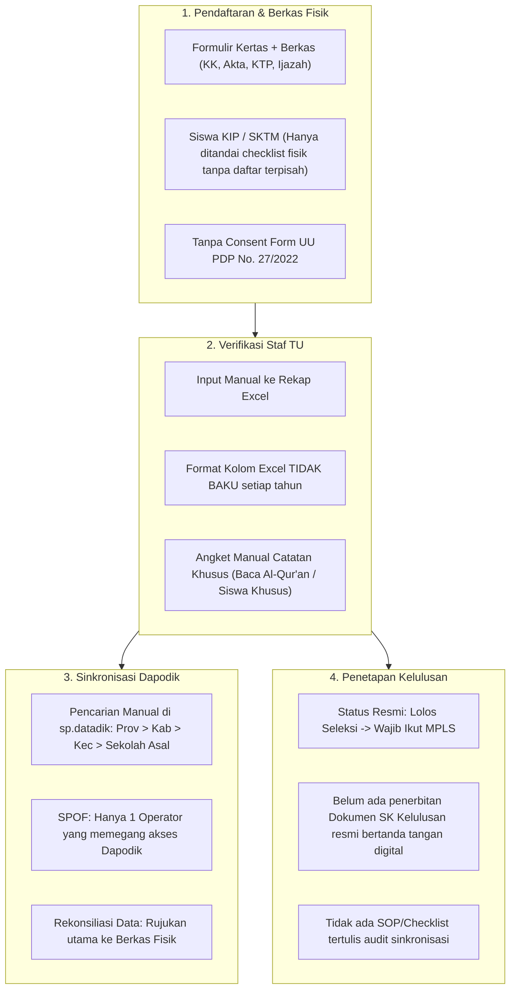

# Laporan Analisis Hasil Wawancara Audit Tata Kelola TI & Rekomendasi Fitur Sistem SPMB SMP YAPIA Ciputat

Dokumen ini memuat analisis mendalam terhadap hasil kuesioner audit tata kelola teknologi informasi (TI) pada Sistem Penerimaan Murid Baru (SPMB) SMP YAPIA Ciputat yang melibatkan 3 pemangku kepentingan kunci (*stakeholders*):
1. **Kepala Sekolah**: Bpk. Via Aprilian Safitri Nur, S.Kom
2. **Operator Dapodik / Sekolah**: Bpk. Ruslan Setiawan
3. **Panitia SPMB / Staf Administrasi TU**: Sdri. Aila Syifa

---

## 1. Ringkasan Eksekutif & Profil Responden

| Pemangku Kepentingan | Responden | Peran & Ruang Lingkup Operasional |
| :--- | :--- | :--- |
| **Kepala Sekolah** | Bpk. Via Aprilian Safitri Nur, S.Kom | Kebijakan SPMB, penetapan SK kepanitiaan, legalitas penetapan siswa baru, otorisasi hak akses, dan kepatuhan regulasi. |
| **Operator Sekolah** | Bpk. Ruslan Setiawan | Penarikan data siswa dari server pusat (`sp.datadik.kemendikdasmen.go.id`), sinkronisasi Dapodik, backup prefill, dan sinkronisasi file Excel. |
| **Staf Administrasi TU** | Sdri. Aila Syifa | Penerimaan berkas fisik, entri data formulir ke Excel, rekap angket observasi khusus, dan penyimpanan arsip fisik pendaftar. |

---

## 2. Matriks Temuan & Kesenjangan Tata Kelola (*Gap Analysis*)

### A. Temuan pada Aspek Hukum & Kepatuhan Regulasi (UU PDP No. 27/2022)
1. **Ketiadaan Klausul Persetujuan Data Pribadi (*Data Consent*)**:
   - Kepala Sekolah mengonfirmasi bahwa saat ini **belum ada formulir atau pernyataan tertulis terkait persetujuan wali murid atas pemrosesan data pribadi** (NIK, No KK, data penghasilan orang tua, dsb.) sesuai mandat UU PDP No. 27/2022.
2. **Kebijakan Retensi & Pemusnahan Data Belum Baku**:
   - Data pendaftar yang tidak diterima atau mengundurkan diri saat ini disimpan hingga 10 tahun tanpa SOP pembersihan atau anonimisasi data sensitif.

### B. Temuan pada Aspek Operasional Data & Interoperabilitas Dapodik
1. **Struktur Kolom Rekap Excel Tidak Baku**:
   - Operator Dapodik menyatakan struktur kolom Excel selama ini **tidak baku**, seringkali disingkat dan berubah mengikuti kebutuhan tahun berjalan, sehingga menyulitkan proses pencocokan data saat impor ke Dapodik.
2. **Proses Penarikan Data Pusat Masih Sangat Manual**:
   - Operator harus memfilter siswa baru satu per satu di portal `sp.datadik.kemendikdasmen.go.id` berdasarkan hierarki: **Provinsi ➔ Kabupaten/Kota ➔ Kecamatan ➔ Kelurahan ➔ Nama Sekolah Asal SD/MI**.
3. **Data Fisik Menjadi Acuan Tunggal (*Single Source of Truth*)**:
   - Ketika ada perbedaan antara data entri digital dan berkas fisik, panitia selalu merujuk ke fisik. Diperlukan penanda verifikasi fisik digital agar tidak terjadi selisih berulang.

### C. Temuan pada Aspek Afirmasi & Penanganan Siswa Khusus
1. **Penanganan Siswa KIP / PIP / SKTM Sangat Rentan Tercecer**:
   - Staf TU mengungkapkan bahwa siswa penerima SKTM/KIP **hanya diberi tanda ceklis fisik manual**, tanpa adanya database atau rekap digital terpisah. Berkasnya digabung dengan siswa umum.
   - Hal ini berisiko tinggi saat penentuan kuota afirmasi, subsidi infak formulir/DSP, maupun pelaporan bansos pendidikan ke dinas.
2. **Catatan Khusus (Kemampuan Baca Al-Qur'an & ABK)**:
   - Tes seleksi di SMP Yapia mencakup angket observasi khusus (misal kemampuan baca Al-Qur'an/Iqra, siswa yang butuh pendampingan literasi/ABK) yang dilaporkan ke Kepala Sekolah untuk pembagian rombongan belajar (rombel) oleh Waka Kesiswaan. Belum ada rekam jejak digital untuk catatan ini.

### D. Temuan pada Aspek Penetapan Kelulusan & Pengamanan Sistem
1. **Alur Penetapan Kelulusan (MPLS sebagai Syarat Final)**:
   - Siswa dinyatakan resmi diterima bukan hanya setelah tes seleksi, melainkan **wajib menyelesaikan kegiatan MPLS (Masa Pengenalan Lingkungan Sekolah)**.
2. **Ketiadaan Surat Keputusan (SK) Kelulusan Digital**:
   - Kepala sekolah belum menandatangani dokumen penetapan secara formal. Dibutuhkan dokumen digital resmi (SK Penerimaan / Bukti Lolos Seleksi ber-QR Code) yang disahkan Kepala Sekolah.
3. **Risiko *Single Point of Failure* (SPOF) Operator**:
   - Akun Dapodik hanya dipegang 1 orang operator tanpa prosedur darurat jika berhalangan. Perlu adanya sistem rekap internal sekolah yang tetap bisa berjalan secara mandiri oleh Staf TU dan Kepsek.

---

## 3. Rekomendasi Fitur-Fitur Baru Sistem SPMB

Berdasarkan temuan di atas, berikut adalah usulan fitur-fitur baru yang diklasifikasikan ke dalam 3 tingkat prioritas:

### 🌟 Prioritas 1 (P1) - Mendesak & Solusi Langsung Masalah Operasional

| No | Modul / Fitur Baru | Deskripsi & Manfaat Operasional | Stakeholder Terdampak |
| :--- | :--- | :--- | :--- |
| **1.1** | **Modul Khusus Jalur Afirmasi (KIP / PIP / SKTM)** | • Input nomor KIP/KKS/SKTM pada form pendaftaran. • Filter khusus di Admin Dashboard: "Pendaftar Jalur Afirmasi/SKTM". • Otomatisasi penyesuaian tarif infak formulir / keringanan biaya. • Mencegah berkas KIP tercecer atau digabung tanpa pencatatan. | Staf TU, Bendahara, Wali Murid |
| **1.2** | **Ekspor Standar Baku Dapodik (Template Kemendikdasmen)** | • Format kolom ekspor Excel yang 100% baku dan sesuai spesifikasi Dapodik. • Pengelompokan pendaftar otomatis berdasarkan **NPSN, Sekolah Asal (SD/MI), dan Kecamatan** untuk mempermudah operator saat menarik data di `sp.datadik`. | Operator Dapodik |
| **1.3** | **Klausul Persetujuan Data Pribadi (UU PDP Consent Checkbox)** | • Penambahan klausul persetujuan pemrosesan data pribadi pada Formulir Pendaftaran Step 5. • Menyimpan bukti persetujuan (waktu & IP) untuk memenuhi UU Perlindungan Data Pribadi No. 27/2022. | Kepala Sekolah, Wali Murid |
| **1.4** | **Checklist Verifikasi Fisik vs Digital ("Physical Audit Match")** | • Toggle verifikasi di modal detail admin: *"Berkas Fisik Telah Diterima & Terverifikasi di TU"*. • Operator Dapodik dapat memfilter siswa yang sudah valid secara fisik sebelum ditarik ke Dapodik. | Staf TU, Operator Dapodik |

---

### 🔹 Prioritas 2 (P2) - Standardisasi Alur Akademik & Tata Kelola Sekolah

| No | Modul / Fitur Baru | Deskripsi & Manfaat Operasional | Stakeholder Terdampak |
| :--- | :--- | :--- | :--- |
| **2.1** | **Modul Observasi Siswa Khusus & Kemampuan Baca Al-Qur'an** | • Pencatatan digital hasil tes penempatan: tingkat kemampuan membaca Al-Qur'an (Iqra/Juz Amma/Al-Qur'an), catatan kebutuhan bimbingan belajar/karakter, atau indikasi ABK. • Fitur ekspor daftar catatan pendampingan untuk diserahkan ke Waka Kesiswaan & Guru Wali Kelas saat pembagian rombel. | Waka Kesiswaan, Guru PAI, Kepala Sekolah |
| **2.2** | **Alur Status Kelulusan Berjenjang (MPLS Milestone)** | • Penambahan status pendaftaran resmi: &nbsp;&nbsp;`DRAFT` ➔ `SUBMITTED` ➔ `VERIFIED` ➔ `LOLOS_SELEKSI` ➔ `MENGIKUTI_MPLS` ➔ `DITERIMA_RESMI` *(Aktif)*. • Sesuai mekanisme penetapan siswa baru di SMP Yapia. | Kepala Sekolah, Panitia SPMB |
| **2.3** | **Penerbitan SK Penerimaan / Surat Kelulusan Digital (QR Code Kepsek)** | • Template cetak PDF Surat Keputusan Kelulusan resmi berlogo sekolah dan QR Code verifikasi tanda tangan digital Kepala Sekolah. • Dapat diunduh langsung oleh wali murid melalui portal cek status. | Kepala Sekolah, Wali Murid |
| **2.4** | **Audit Trail & Activity Logs (Rekam Jejak Verifikasi)** | • Mencatat riwayat setiap perubahan status data pendaftar (siapa admin/staf TU yang mengubah, waktu perubahan, dan catatan revisi berkas). • Menjamin transparansi dan akuntabilitas kepanitiaan. | Kepala Sekolah, Superadmin |

---

### 💡 Prioritas 3 (P3) - Automasi Komunikasi & Retensi Data

| No | Modul / Fitur Baru | Deskripsi & Manfaat Operasional | Stakeholder Terdampak |
| :--- | :--- | :--- | :--- |
| **3.1** | **Integrasi Notifikasi WhatsApp Gateway / Direct WA Click** | • Tombol *1-Click WhatsApp Notification* di dashboard panitia untuk mengirim template pesan otomatis (jadwal tes seleksi, konfirmasi kelulusan, jadwal seragam/MPLS) langsung ke nomor HP orang tua tanpa harus mengetik manual di grup. | Staf TU, Wali Murid |
| **3.2** | **Kebijakan Retensi & Pengarsipan Data Pendaftar (Data Archiving)** | • Fitur arsip otomatis untuk data pendaftar tahun-tahun sebelumnya. • Mekanisme anonimisasi data sensitif pendaftar yang tidak diterima atau mengundurkan diri setelah batas waktu tertentu. | Kepala Sekolah, Operator |

---

## 4. Kesimpulan & Langkah Penerapan

Hasil kuesioner menunjukkan bahwa **masalah utama bukan hanya pada digitasi formulir**, melainkan pada:
1. **Ketiadaan rekap digital untuk siswa KIP/SKTM** (rentan tercecer).
2. **Ketiadaan format baku yang selaras dengan alur kerja Dapodik** (membuat operator kerja ganda).
3. **Kepatuhan hukum UU PDP** yang belum diterapkan pada formulir pendaftaran.
4. **Alur penetapan status pendaftar** yang harus mengakomodasi tahapan seleksi dan penyelesaian MPLS.
