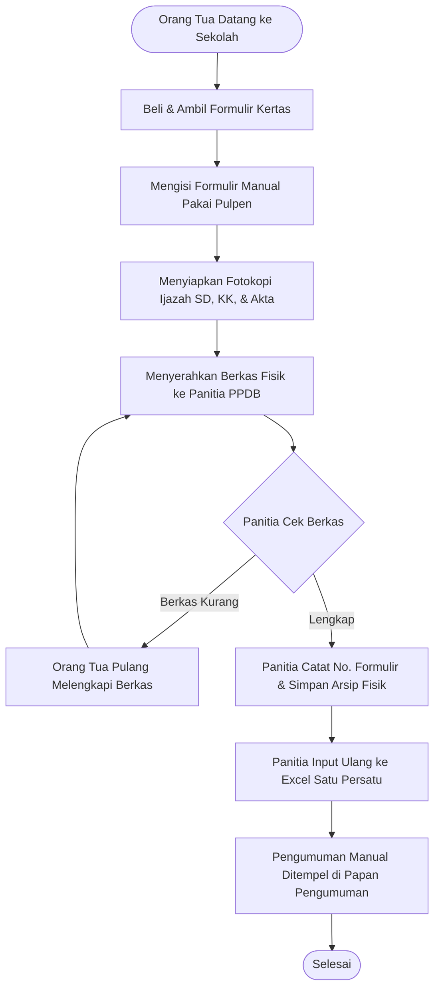
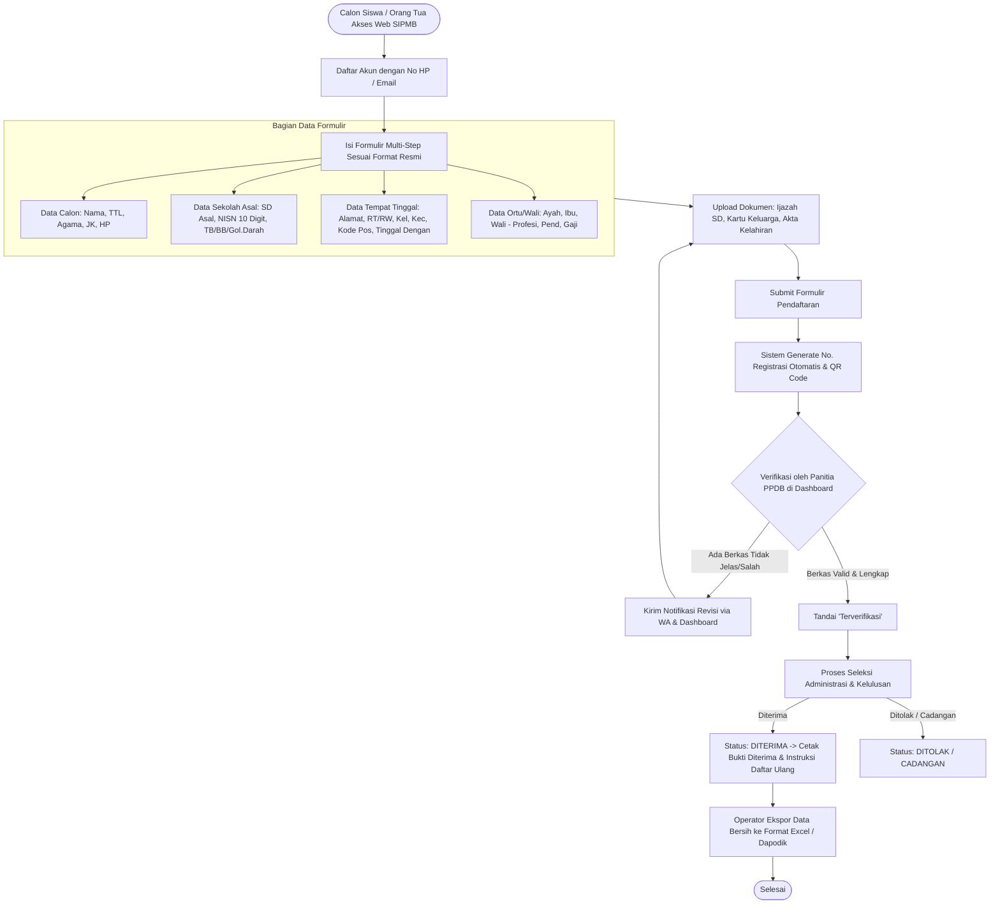

# Business Requirements Document (BRD)
## Sistem Informasi Penerimaan Murid Baru (SIPMB)
### SMP YAPIA Ciputat

---

| Informasi Dokumen | Keterangan |
|---|---|
| **Judul Proyek** | Pengembangan Sistem Informasi Penerimaan Murid Baru (SIPMB) |
| **Instansi** | SMP YAPIA Ciputat, Tangerang Selatan |
| **Versi Dokumen** | 1.0.0 |
| **Status** | Final / Disetujui untuk Pengembangan |
| **Terakhir Diperbarui** | Oktober 2026 |
| **Penulis** | Tim Analis Sistem & Perangkat Lunak |

---

## 1. Ringkasan Eksekutif (Executive Summary)

SMP YAPIA Ciputat merupakan institusi pendidikan tingkat menengah pertama swasta di kawasan Ciputat - Pamulang, Tangerang Selatan. Setiap tahun ajaran baru, sekolah menyelenggarakan Penerimaan Peserta Didik Baru (PPDB / PMB) untuk menjaring calon siswa lulusan Sekolah Dasar (SD/MI) sederajat.

Saat ini, proses pendaftaran masih mengandalkan formulir kertas fisik (sebagaimana terdokumentasi pada berkas pendaftaran nomor `3` calon siswa Alka Alhabsy). Pendekatan konvensional ini menimbulkan sejumlah kendala:
1. Pendaftar atau orang tua harus datang secara langsung untuk mengambil dan mengembalikan formulir fisik.
2. Penulisan manual dengan tulisan tangan sering kali sulit dibaca, memicu kesalahan pencatatan nomor NISN (10 digit), nomor handphone pendaftar, dan nama lengkap yang wajib presisi sesuai Ijazah SD.
3. Panitia PPDB menghabiskan ratusan jam kerja untuk melakukan input ulang (data re-entry) ke dalam spreadsheet Excel dan aplikasi Data Pokok Pendidikan (Dapodik) Kemendikbudristek.
4. Pengelolaan arsip fisik berkas (fotokopi Ijazah SD, Kartu Keluarga, dan Akta Kelahiran) memakan ruang dan berisiko rusak atau terselip.

Pembangunan **SIPMB SMP YAPIA Ciputat** bertujuan mentransformasikan seluruh alur pendaftaran menjadi sistem berbasis web modern, responsif, aman, dan terintegrasi, yang tetap mengadopsi 100% kelengkapan data formulir resmi sekolah.

---

## 2. Analisis Masalah & Kebutuhan Bisnis

### 2.1 Masalah Utama (Problem Statements)

| ID Masalah | Deskripsi Masalah | Dampak Bisnis |
|---|---|---|
| **P-01** | Pengisian formulir manual berbasis kertas | Resiko kesalahan pembacaan karakter tulisan tangan (misal angka 0 dengan huruf O, angka 1 dengan 7, NISN tidak terbaca). |
| **P-02** | Keharusan kehadiran fisik orang tua ke sekolah | Membatasi jangkauan pendaftar yang orang tuanya memiliki kendala waktu kerja di jam operasional sekolah. |
| **P-03** | Rekapitulasi ganda ke Dapodik | Panitia menginput manual berulang kali, memperlambat pelaporan kuota siswa baru ke dinas pendidikan. |
| **P-04** | Verifikasi berkas fisik lambat | Panitia harus mencocokkan dokumen fisik secara manual; status verifikasi sulit dipantau orang tua siswa secara berkala. |
| **P-05** | Ketiadaan notifikasi otomatis | Pengumuman kelulusan, kekurangan berkas, dan instruksi daftar ulang harus disampaikan melalui telepon/SMS manual satu per satu. |

### 2.2 Tujuan Bisnis (Business Objectives)

1. **Digitalisasi Penuh Alur Pendaftaran**: Memungkinkan 100% proses pendaftaran dan pengunggahan berkas secara online melalui smartphone maupun komputer.
2. **Eliminasi Redudansi Input Data**: Menyediakan fitur ekspor data terstruktur yang kompatibel dengan format impor template Dapodik Kementerian Pendidikan.
3. **Peningkatan Akurasi Data**: Memvalidasi format NISN (10 digit numerik), nomor telepon/WhatsApp, dan tanggal lahir secara otomatis di sisi klien dan server.
4. **Peningkatan Kepuasan Pendaftar**: Menyediakan dasbor pelacakan status pendaftaran (*Real-time Status Tracking*) serta pencetakan bukti pendaftaran ber-barcode/QR Code resmi.
5. **Efisiensi Kerja Panitia PPDB**: Memangkas waktu verifikasi berkas hingga 70% melalui antarmuka dasbor verifikasi dokumen digital (preview langsung foto/PDF KK, Akte, dan Ijazah).

---

## 3. Matriks Pemangku Kepentingan (Stakeholders & RACI Matrix)

### 3.1 Identifikasi Stakeholder

- **Calon Siswa & Orang Tua/Wali (Pendaftar)**: Pihak yang mengisi biodata, mengunggah berkas persyaratan, memantau pengumuman, dan mencetak kartu pendaftaran.
- **Panitia PPDB (Operator & Verifikator)**: Tim sekolah yang memverifikasi keabsahan data, memeriksa kelengkapan berkas fisik/digital, menandai status kelulusan, dan melayani pendaftar onsite yang memerlukan bantuan (helpdesk).
- **Ketua Panitia PPDB**: Pejabat yang mengesahkan penerimaan pendaftaran, menyetujui kuota gelombang, dan menerbitkan surat keputusan kelulusan.
- **Bendahara Sekolah / Kasir**: Petugas yang mengonfirmasi penerimaan biaya pendaftaran/formulir atau pembayaran daftar ulang.
- **Kepala Sekolah**: Pimpinan yang memonitor statistik pendaftaran, persentase keterisian kuota, dan laporan demografi calon siswa baru.
- **Operator Dapodik**: Staf yang mengekspor data final siswa yang diterima langsung ke sistem pendataan nasional.

### 3.2 RACI Matrix

*R = Responsible, A = Accountable, C = Consulted, I = Informed*

| Aktivitas Bisnis | Orang Tua / Calon Siswa | Operator PPDB | Ketua Panitia | Bendahara | Kepala Sekolah | Operator Dapodik |
|---|---|---|---|---|---|---|
| Registrasi Akun & Pengisian Biodata | **R / A** | C | I | I | I | I |
| Unggah Ijazah, KK, Akta Kelahiran | **R / A** | C | I | I | I | I |
| Verifikasi Data & Validitas Berkas | I | **R** | A | I | I | C |
| Konfirmasi Pembayaran Formulir / Admisi | I | C | I | **R / A** | I | I |
| Penetapan Hasil Seleksi & Kelulusan | I | C | **R / A** | I | C | I |
| Pengumuman Status ke Calon Siswa | I | **R** | A | I | I | I |
| Pelaporan Eksekutif & Statistik | I | C | C | C | **A** | I |
| Sinkronisasi / Ekspor Data ke Dapodik | I | C | I | I | I | **R / A** |

---

## 4. Analisis Proses Bisnis (AS-IS vs TO-BE)

### 4.1 Proses Saat Ini (AS-IS - Manual Berbasis Kertas)

**Kelemahan AS-IS**: Waktu tunggu lama, antrean fisik, risiko kehilangan berkas fotokopi, input ulang rawan *human error*.

---

### 4.2 Proses Usulan (TO-BE - SIPMB Digital Web-Based)

---

## 5. Ruang Lingkup Proyek (Project Scope)

### 5.1 Dalam Ruang Lingkup (In-Scope)

1. **Portal Publik & Pendaftar**:
   - Beranda informasi PPDB, jadwal gelombang, kuota, persyaratan, dan alur pendaftaran.
   - Pendaftaran akun pendaftar berbasis nomor WhatsApp dan kata sandi.
   - Formulir digital multi-langkah (multi-step wizard) mencakup Bagian A, B, C, D dari formulir resmi.
   - Fitur unggah dokumen foto/PDF (Ijazah SD/SKL, Kartu Keluarga, Akta Kelahiran).
   - Dasbor status pendaftaran *real-time* (Draft, Terkirim, Revisi, Terverifikasi, Diterima, Ditolak).
   - Pengunduhan dan cetak Bukti Registrasi Resmi (PDF) lengkap dengan QR Code validasi keaslian.
2. **Dasbor Panitia & Manajemen (Back-Office)**:
   - Autentikasi dan Role-Based Access Control (Admin Utama, Verifikator, Bendahara, Pimpinan/Kepsek).
   - Manajemen Gelombang Pendaftaran (Buka/Tutup gelombang, penentuan kuota per gelombang, batas tanggal pendaftaran).
   - Modul Verifikasi Dokumen Digital (split-screen: biodata vs preview file dokumen pendukung).
   - Modul Kelulusan dan Pengumuman Massal (*Bulk Approval*).
   - Ekspor Data Calon Siswa Terverifikasi ke format Excel/CSV sesuai skema kolom Dapodik.
   - Modul Audit Trail (merekam jejak aktivitas siapa yang memverifikasi, mengedit, atau mengubah status).
3. **Modul Onsite Helpdesk (Pendaftaran di Tempat)**:
   - Mode input panitia untuk melayani orang tua yang datang langsung ke sekolah tanpa smartphone/internet.

### 5.2 Luar Ruang Lingkup (Out-of-Scope)

- Modul Ujian Masuk berbasis CBT online berwaktu ketat (dapat diintegrasikan pada Fase 2 jika ada seleksi akademis).
- Integrasi Payment Gateway otomatis (Midtrans/Xendit) untuk pembayaran formulir (Fase 1 menggunakan konfirmasi transfer manual/kasir onsite).
- Sistem Informasi Akademik (SIAKAD) perkuliahan/sekolah harian setelah siswa resmi aktif (fokus SIPMB hanya sampai tahap Daftar Ulang).

---

## 6. Aturan Bisnis (Business Rules)

| Kode Aturan | Kategori | Deskripsi Aturan Bisnis |
|---|---|---|
| **BR-01** | Validitas NISN | Nomor Induk Siswa Nasional (NISN) wajib terdiri dari tepat 10 digit numerik dan harus unik (satu NISN hanya boleh didaftarkan 1 kali dalam 1 tahun ajaran). |
| **BR-02** | Usia Calon Siswa | Calon siswa SMP pada tanggal 1 Juli tahun ajaran baru berusia setinggi-tingginya 15 tahun dan memiliki ijazah/surat keterangan tamat belajar SD/sederajat. |
| **BR-03** | Kelengkapan Dokumen Wajib | Berkas pendaftaran tidak dapat disubmit (dikirim ke panitia) sebelum ketiga dokumen wajib diunggah: (1) Ijazah/SKL, (2) Kartu Keluarga, (3) Akta Kelahiran. Format file yang diizinkan: JPG, JPEG, PNG, PDF dengan ukuran maksimal 2 MB per file. |
| **BR-04** | Nomor Registrasi | Format nomor pendaftaran otomatis di-*generate* oleh sistem dengan pola: `REG-{TAHUN}-{GELOMBANG}-{URUT4DIGIT}` (contoh: `REG-2026-G1-0003`). |
| **BR-05** | Perubahan Data | Data pendaftaran dapat disunting bebas oleh pendaftar selama status masih `DRAFT` atau `REVISI`. Saat berstatus `SUBMITTED` atau `TERVERIFIKASI`, pendaftar tidak dapat merubah data tanpa izin panitia. |
| **BR-06** | Penanganan Wali | Jika calon siswa tinggal bersama orang tua (`TINGGAL_DENGAN = ORANG_TUA`), data wali bersifat opsional. Jika calon siswa memilih `TINGGAL_DENGAN = WALI`, maka isian Data Wali (Nama, Pendidikan, Pekerjaan, Alamat Wali) wajib diisi lengkap. |
| **BR-07** | Ketentuan Kontak | Nomor telepon/handphone calon siswa atau orang tua wajib aktif dan terhubung ke layanan WhatsApp untuk pengiriman notifikasi status verifikasi berkas. |

---

## 7. Metrik Keberhasilan & KPI (Key Performance Indicators)

1. **Waktu Tunggu Verifikasi**: Penurunan rata-rata waktu verifikasi berkas dari 3-5 hari kerja menjadi < 24 jam kerja sejak berkas disubmit.
2. **Tingkat Akurasi Data (Error Rate)**: Menekan kesalahan input NISN dan nama siswa menjadi 0% berkat validasi otomatis dan unggahan berkas sumber ijazah.
3. **Penyelesaian Impor Dapodik**: Data 100% siswa baru yang diterima dapat diekspor dan siap diimpor ke Dapodik dalam waktu < 2 jam setelah penetapan kelulusan selesai.
4. **Adopsi Pengguna**: Minimal 85% pendaftar mendaftar secara mandiri secara daring (online), dan 15% dibantu panitia via *Helpdesk Onsite*.
5. **Ketersediaan Sistem (Uptime)**: Sistem mencapai SLA *availability* 99.5% selama masa puncak pendaftaran gelombang PPDB.
