# Entity Relationship Diagram & Database Schema (ERD)
## Sistem Informasi Penerimaan Murid Baru (SIPMB)
### SMP YAPIA Ciputat

---

| Informasi Dokumen | Keterangan |
|---|---|
| **Database Engine Target** | Cloudflare D1 (Serverless SQLite) / PostgreSQL 15+ |
| **Konvensi Penamaan** | `snake_case` (Tabel jamak/tunggal konsisten, Kolom berhuruf kecil) |
| **Normalisasi Data** | 3NF (Third Normal Form) |
| **Versi Dokumen** | 1.1.0 (Mendukung Cloudflare D1 DDL) |
| **Status** | Disetujui untuk Implementasi DDL & Migrasi (DDL D1: [`deploy/d1/schema.sql`](file:///home/arizainalf/Project/smp-yapia-ciputat/deploy/d1/schema.sql)) |

---

## 1. Diagram Relasi Entitas (Mermaid ERD)

```mermaid
erDiagram
    USERS ||--o{ CALON_SISWA : "mendaftar sebagai"
    USERS ||--o{ VERIFIKASI_LOG : "melakukan verifikasi"
    USERS ||--o{ AUDIT_LOGS : "mencatat aktivitas"
    
    GELOMBANG_PENDAFTARAN ||--o{ CALON_SISWA : "mengelompokkan"
    
    CALON_SISWA ||--|| SEKOLAH_ASAL : "memiliki riwayat"
    CALON_SISWA ||--|| ALAMAT_SISWA : "berdomisili di"
    CALON_SISWA ||--|{ ORANG_TUA_WALI : "memiliki orang tua/wali"
    CALON_SISWA ||--|{ BERKAS_PENDAFTARAN : "mengunggah berkas"
    CALON_SISWA ||--o{ PEMBAYARAN_PENDAFTARAN : "melakukan transaksi"
    CALON_SISWA ||--o{ VERIFIKASI_LOG : "riwayat status pendaftaran"

    USERS {
        uuid id PK
        varchar nama_lengkap
        varchar no_hp UK
        varchar email UK
        varchar password_hash
        varchar role "ADMIN | OPERATOR | BENDAHARA | KEPSEK | PENDAFTAR"
        boolean is_active
        timestamp created_at
        timestamp updated_at
    }

    GELOMBANG_PENDAFTARAN {
        int id PK
        varchar nama_gelombang
        varchar tahun_ajaran
        date tanggal_buka
        date tanggal_tutup
        int kuota_maksimal
        decimal biaya_pendaftaran
        boolean is_active
        timestamp created_at
    }

    CALON_SISWA {
        uuid id PK
        uuid user_id FK
        int gelombang_id FK
        varchar nomor_pendaftaran UK "REG-2026-G1-0003"
        varchar nama_lengkap "Sesuai Ijazah SD"
        varchar tempat_lahir
        date tanggal_lahir
        varchar jenis_kelamin "LAKI-LAKI | PEREMPUAN"
        varchar agama "ISLAM | KATOLIK | PROTESTAN | BUDHA | HINDU | LAINNYA"
        varchar no_hp "082113529348"
        varchar status_pendaftaran "DRAFT | SUBMITTED | REVISI | TERVERIFIKASI | DITERIMA | DITOLAK | DAFTAR_ULANG"
        text catatan_verifikasi
        timestamp tanggal_submit
        timestamp created_at
        timestamp updated_at
    }

    SEKOLAH_ASAL {
        uuid id PK
        uuid calon_siswa_id FK, UK
        varchar nama_sekolah "SD Negeri Pondok Cabe Ilir 02"
        text alamat_sekolah "Jl. Talas II Kel. Pondok Cabe Ilir Kec. Pamulang"
        varchar nisn UK "10 digit (3121974130)"
        numeric berat_badan "dalam Kg (45)"
        numeric tinggi_badan "dalam Cm (145)"
        varchar golongan_darah "A | B | AB | O | LAINNYA"
        timestamp created_at
        timestamp updated_at
    }

    ALAMAT_SISWA {
        uuid id PK
        uuid calon_siswa_id FK, UK
        text alamat_jalan "Jl. Talas II"
        varchar rt "06"
        varchar rw "01"
        varchar no_rumah "19"
        varchar kelurahan "Pondok Cabe Ilir"
        varchar kecamatan "Pamulang"
        varchar kode_pos "15418"
        varchar no_telp_rumah
        varchar tinggal_dengan "ORANG_TUA | WALI | ASRAMA | LAINNYA"
        timestamp created_at
        timestamp updated_at
    }

    ORANG_TUA_WALI {
        uuid id PK
        uuid calon_siswa_id FK
        varchar hubungan "AYAH | IBU | WALI"
        varchar nama "Sesuai Ijazah"
        varchar pendidikan_terakhir "SD | SMP | SMA | D3 | S1 | S2"
        int tahun_lahir "1980"
        varchar pekerjaan "Karyawan Swasta | IRT | dll"
        decimal penghasilan_bulanan "3500000"
        varchar no_telp
        text alamat_lengkap "Wajib diisi jika WALI"
        timestamp created_at
        timestamp updated_at
    }

    BERKAS_PENDAFTARAN {
        uuid id PK
        uuid calon_siswa_id FK
        varchar jenis_berkas "IJAZAH_SD | KARTU_KELUARGA | AKTA_KELAHIRAN | PAS_FOTO"
        varchar file_path "s3/minio key or relative storage path"
        varchar original_file_name
        bigint file_size_bytes
        varchar mime_type "image/jpeg | application/pdf"
        varchar status_verifikasi "PENDING | VALID | TIDAK_VALID"
        text catatan_revisi
        timestamp verified_at
        timestamp created_at
        timestamp updated_at
    }

    PEMBAYARAN_PENDAFTARAN {
        uuid id PK
        uuid calon_siswa_id FK
        varchar nomor_transaksi UK
        decimal jumlah
        varchar metode_pembayaran "TRANSFER_BANK | TUNAI_KASIR | QRIS"
        varchar bukti_bayar_url
        varchar status_pembayaran "MENUNGGU_VERIFIKASI | LUNAS | DITOLAK"
        uuid diverifikasi_oleh FK
        timestamp tanggal_bayar
        timestamp created_at
    }

    VERIFIKASI_LOG {
        uuid id PK
        uuid calon_siswa_id FK
        uuid verifikator_id FK
        varchar status_sebelumnya
        varchar status_baru
        text catatan
        timestamp created_at
    }

    AUDIT_LOGS {
        uuid id PK
        uuid user_id FK
        varchar action "CREATE | UPDATE | DELETE | STATUS_CHANGE"
        varchar entity_name
        varchar entity_id
        jsonb old_values
        jsonb new_values
        varchar ip_address
        varchar user_agent
        timestamp created_at
    }
```



---

## 2. Kamus Data (Data Dictionary)

### 2.1 Tabel `calon_siswa` (Tabel Inti Biodata Pendaftar)
Menyimpan data identitas diri calon murid baru yang diadopsi dari Formulir Bagian A.

| Kolom | Tipe Data | Nullable | Constraint / Default | Keterangan |
|---|---|---|---|---|
| `id` | `UUID` | No | PK, `gen_random_uuid()` | Pengidentifikasi unik calon siswa |
| `user_id` | `UUID` | No | FK ➔ `users(id)` | Akun pengguna yang mendaftarkan siswa |
| `gelombang_id` | `INT` | No | FK ➔ `gelombang_pendaftaran(id)` | Gelombang pendaftaran yang dipilih |
| `nomor_pendaftaran` | `VARCHAR(30)` | No | UNIQUE | Kode unik registrasi (misal: `REG-2026-G1-0003`) |
| `nama_lengkap` | `VARCHAR(150)` | No | - | Nama lengkap resmi sesuai Ijazah SD |
| `tempat_lahir` | `VARCHAR(60)` | No | - | Kota/Kabupaten tempat lahir (contoh: Jakarta) |
| `tanggal_lahir` | `DATE` | No | - | Tanggal lahir pendaftar (contoh: 2012-06-01) |
| `jenis_kelamin` | `VARCHAR(20)` | No | CHECK IN ('LAKI-LAKI', 'PEREMPUAN') | Jenis kelamin calon siswa |
| `agama` | `VARCHAR(30)` | No | CHECK IN ('ISLAM', 'KATOLIK', 'PROTESTAN', 'BUDHA', 'HINDU', 'KONGHUCU', 'LAINNYA') | Agama resmi |
| `no_hp` | `VARCHAR(20)` | No | - | Nomor WhatsApp aktif siswa / orang tua |
| `status_pendaftaran` | `VARCHAR(30)` | No | Default: `'DRAFT'` | Siklus status administrasi siswa |
| `catatan_verifikasi` | `TEXT` | Yes | - | Catatan panitia bila ada revisi berkas |
| `tanggal_submit` | `TIMESTAMPTZ` | Yes | - | Waktu pendaftar menekan tombol final submit |
| `created_at` | `TIMESTAMPTZ` | No | Default: `NOW()` | Waktu pembuatan data |
| `updated_at` | `TIMESTAMPTZ` | No | Default: `NOW()` | Waktu update terakhir |

### 2.2 Tabel `sekolah_asal` (Pendidikan Sebelumnya & Fisik)
Menyimpan data pendidikan dasar sebelumnya dan profil fisik calon siswa dari Formulir Bagian B.

| Kolom | Tipe Data | Nullable | Constraint / Default | Keterangan |
|---|---|---|---|---|
| `id` | `UUID` | No | PK, `gen_random_uuid()` | ID unik entri |
| `calon_siswa_id` | `UUID` | No | FK ➔ `calon_siswa(id)`, UNIQUE | Relasi 1-to-1 dengan calon siswa |
| `nama_sekolah` | `VARCHAR(150)` | No | - | Nama SD/MI asal (contoh: SD Negeri Pondok Cabe Ilir 02) |
| `alamat_sekolah` | `TEXT` | No | - | Alamat lengkap sekolah asal |
| `nisn` | `VARCHAR(10)` | No | UNIQUE | Tepat 10 digit nomor NISN Kemendikbud |
| `berat_badan` | `NUMERIC(5,2)` | Yes | - | Berat badan pendaftar dalam satuan Kilogram (Kg) |
| `tinggi_badan` | `NUMERIC(5,2)` | Yes | - | Tinggi badan pendaftar dalam satuan Centimeter (Cm) |
| `golongan_darah` | `VARCHAR(10)` | Yes | CHECK IN ('A', 'B', 'AB', 'O', 'LAINNYA') | Golongan darah |

### 2.3 Tabel `alamat_siswa` (Keterangan Tempat Tinggal)
Menyimpan data tempat tinggal dan status domisili calon siswa dari Formulir Bagian C.

| Kolom | Tipe Data | Nullable | Constraint / Default | Keterangan |
|---|---|---|---|---|
| `id` | `UUID` | No | PK, `gen_random_uuid()` | ID unik entri |
| `calon_siswa_id` | `UUID` | No | FK ➔ `calon_siswa(id)`, UNIQUE | Relasi 1-to-1 dengan calon siswa |
| `alamat_jalan` | `TEXT` | No | - | Nama jalan / perumahan / gang (contoh: Jl. Talas II) |
| `rt` | `VARCHAR(5)` | No | - | Rukun Tetangga (contoh: 06) |
| `rw` | `VARCHAR(5)` | No | - | Rukun Warga (contoh: 01) |
| `no_rumah` | `VARCHAR(10)` | No | - | Nomor rumah pendaftar (contoh: 19) |
| `kelurahan` | `VARCHAR(100)`| No | - | Kelurahan / Desa (contoh: Pondok Cabe Ilir) |
| `kecamatan` | `VARCHAR(100)`| No | - | Kecamatan domisili (contoh: Pamulang) |
| `kode_pos` | `VARCHAR(5)` | No | - | Kode pos 5 digit (contoh: 15418) |
| `no_telp_rumah` | `VARCHAR(20)` | Yes | - | Nomor telepon rumah kabel (jika ada) |
| `tinggal_dengan` | `VARCHAR(30)` | No | CHECK IN ('ORANG_TUA', 'WALI', 'ASRAMA', 'LAINNYA') | Calon siswa tinggal bersama siapa |

### 2.4 Tabel `orang_tua_wali` (Data Ayah, Ibu, dan Wali)
Menyimpan rincian data orang tua dan wali calon siswa dari Formulir Bagian D.

| Kolom | Tipe Data | Nullable | Constraint / Default | Keterangan |
|---|---|---|---|---|
| `id` | `UUID` | No | PK, `gen_random_uuid()` | ID unik entri |
| `calon_siswa_id` | `UUID` | No | FK ➔ `calon_siswa(id)` | Relasi many-to-one (1 siswa punya Ayah, Ibu, Wali) |
| `hubungan` | `VARCHAR(10)` | No | CHECK IN ('AYAH', 'IBU', 'WALI') | Peran dalam keluarga |
| `nama` | `VARCHAR(150)` | No | - | Nama lengkap orang tua / wali sesuai ijazah/KTP |
| `pendidikan_terakhir`| `VARCHAR(50)`| No | - | SD, SMP, SMA, D1, D2, D3, S1, S2, S3, TIDAK_SEKOLAH |
| `tahun_lahir` | `INT` | Yes | - | Tahun lahir 4 digit (contoh: 1980) |
| `pekerjaan` | `VARCHAR(100)`| No | - | Pekerjaan (Karyawan Swasta, IRT, PNS, dll) |
| `penghasilan_bulanan`| `DECIMAL(14,2)`| Yes | - | Estimasi nominal penghasilan bulanan dalam Rupiah |
| `no_telp` | `VARCHAR(20)` | Yes | - | Nomor kontak orang tua/wali |
| `alamat_lengkap` | `TEXT` | Yes | - | Alamat domisili wali (diwajibkan bila hubungan=WALI) |

### 2.5 Tabel `berkas_pendaftaran` (Lampiran Dokumen Persyaratan)
Menyimpan metadata file pindaian/foto dokumen persyaratan yang diunggah pendaftar.

| Kolom | Tipe Data | Nullable | Constraint / Default | Keterangan |
|---|---|---|---|---|
| `id` | `UUID` | No | PK, `gen_random_uuid()` | ID unik berkas |
| `calon_siswa_id` | `UUID` | No | FK ➔ `calon_siswa(id)` | Calon siswa pemilik berkas |
| `jenis_berkas` | `VARCHAR(30)` | No | CHECK IN ('IJAZAH_SD', 'KARTU_KELUARGA', 'AKTA_KELAHIRAN', 'PAS_FOTO', 'BUKTI_PEMBAYARAN') | Tipe lampiran resmi |
| `file_path` | `TEXT` | No | - | Lokasi penyimpanan di Object Storage / S3 Key |
| `original_file_name`| `VARCHAR(255)`| No | - | Nama file asli saat diunggah |
| `file_size_bytes` | `BIGINT` | No | - | Ukuran file dalam bytes (maksimal 2.097.152 bytes) |
| `mime_type` | `VARCHAR(100)`| No | - | Format MIME (misal: `image/jpeg`, `application/pdf`) |
| `status_verifikasi` | `VARCHAR(20)` | No | Default: `'PENDING'` | Status kelayakan berkas (`PENDING`, `VALID`, `REVISI`) |
| `catatan_revisi` | `TEXT` | Yes | - | Keterangan panitia jika berkas ditolak/buram |

---

## 3. Skrip DDL Lengkap (PostgreSQL Ready-to-Run)

```sql
-- =========================================================================
-- DDL SCHEMA: SISTEM INFORMASI PENERIMAAN MURID BARU (SIPMB) SMP YAPIA CIPUTAT
-- Versi: 1.0.0
-- Database Engine: PostgreSQL 15+
-- =========================================================================

-- 1. EXTENSIONS
CREATE EXTENSION IF NOT EXISTS "uuid-ossp";
CREATE EXTENSION IF NOT EXISTS "pgcrypto";

-- 2. TIPE ENUMERASI
CREATE TYPE role_user_enum AS ENUM ('SUPERADMIN', 'PANITIA_VERIFIKATOR', 'BENDAHARA', 'KEPALA_SEKOLAH', 'PENDAFTAR');
CREATE TYPE jenis_kelamin_enum AS ENUM ('LAKI-LAKI', 'PEREMPUAN');
CREATE TYPE agama_enum AS ENUM ('ISLAM', 'KATOLIK', 'PROTESTAN', 'BUDHA', 'HINDU', 'KONGHUCU', 'LAINNYA');
CREATE TYPE golongan_darah_enum AS ENUM ('A', 'B', 'AB', 'O', 'LAINNYA', 'TIDAK_TAHU');
CREATE TYPE tinggal_dengan_enum AS ENUM ('ORANG_TUA', 'WALI', 'ASRAMA', 'LAINNYA');
CREATE TYPE status_pendaftaran_enum AS ENUM (
    'DRAFT',
    'SUBMITTED',
    'REVISI',
    'TERVERIFIKASI',
    'LULUS_SELEKSI',
    'CADANGAN',
    'TIDAK_LULUS',
    'DAFTAR_ULANG'
);
CREATE TYPE jenis_berkas_enum AS ENUM (
    'IJAZAH_SD',
    'KARTU_KELUARGA',
    'AKTA_KELAHIRAN',
    'PAS_FOTO',
    'BUKTI_PEMBAYARAN'
);
CREATE TYPE status_verifikasi_berkas_enum AS ENUM ('PENDING', 'VALID', 'REVISI');
CREATE TYPE hubungan_keluarga_enum AS ENUM ('AYAH', 'IBU', 'WALI');
CREATE TYPE status_bayar_enum AS ENUM ('MENUNGGU_VERIFIKASI', 'LUNAS', 'DITOLAK');

-- 3. TABEL USERS (Autentikasi Akun)
CREATE TABLE users (
    id UUID PRIMARY KEY DEFAULT gen_random_uuid(),
    nama_lengkap VARCHAR(150) NOT NULL,
    no_hp VARCHAR(20) NOT NULL UNIQUE,
    email VARCHAR(100) UNIQUE,
    password_hash VARCHAR(255) NOT NULL,
    role role_user_enum NOT NULL DEFAULT 'PENDAFTAR',
    is_active BOOLEAN NOT NULL DEFAULT TRUE,
    created_at TIMESTAMPTZ NOT NULL DEFAULT NOW(),
    updated_at TIMESTAMPTZ NOT NULL DEFAULT NOW()
);

-- 4. TABEL GELOMBANG_PENDAFTARAN
CREATE TABLE gelombang_pendaftaran (
    id SERIAL PRIMARY KEY,
    nama_gelombang VARCHAR(100) NOT NULL, -- Contoh: Gelombang 1 TA 2026/2027
    tahun_ajaran VARCHAR(20) NOT NULL,    -- 2026/2027
    tanggal_buka DATE NOT NULL,
    tanggal_tutup DATE NOT NULL,
    kuota_maksimal INT NOT NULL DEFAULT 120,
    biaya_pendaftaran DECIMAL(12,2) NOT NULL DEFAULT 150000.00,
    is_active BOOLEAN NOT NULL DEFAULT TRUE,
    created_at TIMESTAMPTZ NOT NULL DEFAULT NOW(),
    updated_at TIMESTAMPTZ NOT NULL DEFAULT NOW()
);

-- 5. TABEL CALON_SISWA (Master Biodata Siswa)
CREATE TABLE calon_siswa (
    id UUID PRIMARY KEY DEFAULT gen_random_uuid(),
    user_id UUID NOT NULL REFERENCES users(id) ON DELETE CASCADE,
    gelombang_id INT NOT NULL REFERENCES gelombang_pendaftaran(id) ON DELETE RESTRICT,
    nomor_pendaftaran VARCHAR(30) NOT NULL UNIQUE,
    nama_lengkap VARCHAR(150) NOT NULL,
    tempat_lahir VARCHAR(60) NOT NULL,
    tanggal_lahir DATE NOT NULL,
    jenis_kelamin jenis_kelamin_enum NOT NULL,
    agama agama_enum NOT NULL,
    no_hp VARCHAR(20) NOT NULL,
    status_pendaftaran status_pendaftaran_enum NOT NULL DEFAULT 'DRAFT',
    catatan_verifikasi TEXT,
    tanggal_submit TIMESTAMPTZ,
    created_at TIMESTAMPTZ NOT NULL DEFAULT NOW(),
    updated_at TIMESTAMPTZ NOT NULL DEFAULT NOW()
);

CREATE INDEX idx_calon_siswa_status ON calon_siswa(status_pendaftaran);
CREATE INDEX idx_calon_siswa_gelombang ON calon_siswa(gelombang_id);
CREATE INDEX idx_calon_siswa_no_pendaftaran ON calon_siswa(nomor_pendaftaran);

-- 6. TABEL SEKOLAH_ASAL (Bagian B)
CREATE TABLE sekolah_asal (
    id UUID PRIMARY KEY DEFAULT gen_random_uuid(),
    calon_siswa_id UUID NOT NULL UNIQUE REFERENCES calon_siswa(id) ON DELETE CASCADE,
    nama_sekolah VARCHAR(150) NOT NULL,
    alamat_sekolah TEXT NOT NULL,
    nisn VARCHAR(10) NOT NULL UNIQUE,
    berat_badan NUMERIC(5,2),
    tinggi_badan NUMERIC(5,2),
    golongan_darah golongan_darah_enum DEFAULT 'TIDAK_TAHU',
    created_at TIMESTAMPTZ NOT NULL DEFAULT NOW(),
    updated_at TIMESTAMPTZ NOT NULL DEFAULT NOW()
);

CREATE INDEX idx_sekolah_asal_nisn ON sekolah_asal(nisn);

-- 7. TABEL ALAMAT_SISWA (Bagian C)
CREATE TABLE alamat_siswa (
    id UUID PRIMARY KEY DEFAULT gen_random_uuid(),
    calon_siswa_id UUID NOT NULL UNIQUE REFERENCES calon_siswa(id) ON DELETE CASCADE,
    alamat_jalan TEXT NOT NULL,
    rt VARCHAR(5) NOT NULL,
    rw VARCHAR(5) NOT NULL,
    no_rumah VARCHAR(10) NOT NULL,
    kelurahan VARCHAR(100) NOT NULL,
    kecamatan VARCHAR(100) NOT NULL,
    kode_pos VARCHAR(5) NOT NULL,
    no_telp_rumah VARCHAR(20),
    tinggal_dengan tinggal_dengan_enum NOT NULL DEFAULT 'ORANG_TUA',
    created_at TIMESTAMPTZ NOT NULL DEFAULT NOW(),
    updated_at TIMESTAMPTZ NOT NULL DEFAULT NOW()
);

-- 8. TABEL ORANG_TUA_WALI (Bagian D)
CREATE TABLE orang_tua_wali (
    id UUID PRIMARY KEY DEFAULT gen_random_uuid(),
    calon_siswa_id UUID NOT NULL REFERENCES calon_siswa(id) ON DELETE CASCADE,
    hubungan hubungan_keluarga_enum NOT NULL,
    nama VARCHAR(150) NOT NULL,
    pendidikan_terakhir VARCHAR(50) NOT NULL,
    tahun_lahir INT,
    pekerjaan VARCHAR(100) NOT NULL,
    penghasilan_bulanan DECIMAL(14,2),
    no_telp VARCHAR(20),
    alamat_lengkap TEXT, -- Wajib untuk WALI jika alamat berbeda
    created_at TIMESTAMPTZ NOT NULL DEFAULT NOW(),
    updated_at TIMESTAMPTZ NOT NULL DEFAULT NOW(),
    CONSTRAINT uq_siswa_hubungan UNIQUE (calon_siswa_id, hubungan)
);

-- 9. TABEL BERKAS_PENDAFTARAN (Lampiran Ijazah, KK, Akte)
CREATE TABLE berkas_pendaftaran (
    id UUID PRIMARY KEY DEFAULT gen_random_uuid(),
    calon_siswa_id UUID NOT NULL REFERENCES calon_siswa(id) ON DELETE CASCADE,
    jenis_berkas jenis_berkas_enum NOT NULL,
    file_path TEXT NOT NULL,
    original_file_name VARCHAR(255) NOT NULL,
    file_size_bytes BIGINT NOT NULL,
    mime_type VARCHAR(100) NOT NULL,
    status_verifikasi status_verifikasi_berkas_enum NOT NULL DEFAULT 'PENDING',
    catatan_revisi TEXT,
    verified_at TIMESTAMPTZ,
    created_at TIMESTAMPTZ NOT NULL DEFAULT NOW(),
    updated_at TIMESTAMPTZ NOT NULL DEFAULT NOW(),
    CONSTRAINT uq_siswa_berkas UNIQUE (calon_siswa_id, jenis_berkas)
);

-- 10. TABEL PEMBAYARAN_PENDAFTARAN
CREATE TABLE pembayaran_pendaftaran (
    id UUID PRIMARY KEY DEFAULT gen_random_uuid(),
    calon_siswa_id UUID NOT NULL REFERENCES calon_siswa(id) ON DELETE CASCADE,
    nomor_transaksi VARCHAR(50) NOT NULL UNIQUE,
    jumlah DECIMAL(12,2) NOT NULL,
    metode_pembayaran VARCHAR(50) NOT NULL DEFAULT 'TRANSFER_BANK',
    bukti_bayar_url TEXT,
    status_pembayaran status_bayar_enum NOT NULL DEFAULT 'MENUNGGU_VERIFIKASI',
    diverifikasi_oleh UUID REFERENCES users(id) ON DELETE SET NULL,
    tanggal_bayar TIMESTAMPTZ,
    created_at TIMESTAMPTZ NOT NULL DEFAULT NOW()
);

-- 11. TABEL VERIFIKASI_LOG (Riwayat Perubahan Status Pendaftaran)
CREATE TABLE verifikasi_log (
    id UUID PRIMARY KEY DEFAULT gen_random_uuid(),
    calon_siswa_id UUID NOT NULL REFERENCES calon_siswa(id) ON DELETE CASCADE,
    verifikator_id UUID REFERENCES users(id) ON DELETE SET NULL,
    status_sebelumnya status_pendaftaran_enum,
    status_baru status_pendaftaran_enum NOT NULL,
    catatan TEXT,
    created_at TIMESTAMPTZ NOT NULL DEFAULT NOW()
);

-- 12. TABEL AUDIT_LOGS (Kepatuhan Keamanan & Audit Trail)
CREATE TABLE audit_logs (
    id UUID PRIMARY KEY DEFAULT gen_random_uuid(),
    user_id UUID REFERENCES users(id) ON DELETE SET NULL,
    action VARCHAR(50) NOT NULL,
    entity_name VARCHAR(50) NOT NULL,
    entity_id VARCHAR(50) NOT NULL,
    old_values JSONB,
    new_values JSONB,
    ip_address VARCHAR(45),
    user_agent TEXT,
    created_at TIMESTAMPTZ NOT NULL DEFAULT NOW()
);
```

---

## 4. Seeder Data Contoh (Berdasarkan Formulir Asli Gambar WhatsApp)

Berikut data *sample* yang merepresentasikan berkas formulir nomor `3` calon siswa **Alka Alhabsy**:

```sql
-- 1. Insert Data Akun User (Pendaftar / Orang Tua Alka)
INSERT INTO users (id, nama_lengkap, no_hp, email, password_hash, role)
VALUES (
    'a0eebc99-9c0b-4ef8-bb6d-6bb9bd380a11',
    'Tria (Orang Tua Alka Alhabsy)',
    '082113529348',
    'tria.alka@example.com',
    '$2a$12$e0MYzXyjpJS7Pd0RVvPGcOQhEomlVp6Gq.7qM/0a4V6tqP3sP1YjS', -- bcrypt hash
    'PENDAFTAR'
);

-- 2. Insert Gelombang Pendaftaran
INSERT INTO gelombang_pendaftaran (id, nama_gelombang, tahun_ajaran, tanggal_buka, tanggal_tutup, kuota_maksimal, biaya_pendaftaran, is_active)
VALUES (
    1,
    'Gelombang 1 PPDB SMP YAPIA Ciputat',
    '2026/2027',
    '2026-01-01',
    '2026-05-31',
    150,
    150000.00,
    TRUE
);

-- 3. Insert Calon Siswa (Bagian A: Keterangan Calon)
INSERT INTO calon_siswa (
    id,
    user_id,
    gelombang_id,
    nomor_pendaftaran,
    nama_lengkap,
    tempat_lahir,
    tanggal_lahir,
    jenis_kelamin,
    agama,
    no_hp,
    status_pendaftaran,
    tanggal_submit
) VALUES (
    'b1eebc99-9c0b-4ef8-bb6d-6bb9bd380a22',
    'a0eebc99-9c0b-4ef8-bb6d-6bb9bd380a11',
    1,
    'REG-2026-G1-0003',
    'Alka alhabsy',
    'Jakarta',
    '2012-06-01',
    'LAKI-LAKI',
    'ISLAM',
    '082113529348',
    'TERVERIFIKASI',
    '2026-10-15 17:07:43+07'
);

-- 4. Insert Sekolah Asal (Bagian B: Keterangan Pendidikan Sebelumnya & Fisik)
INSERT INTO sekolah_asal (
    calon_siswa_id,
    nama_sekolah,
    alamat_sekolah,
    nisn,
    berat_badan,
    tinggi_badan,
    golongan_darah
) VALUES (
    'b1eebc99-9c0b-4ef8-bb6d-6bb9bd380a22',
    'SD Negeri Pondok Cabe Ilir 02',
    'Jl. Talas II Kel. Pondok Cabe Ilir Kec. Pamulang',
    '3121974130',
    45.00,
    145.00,
    'O'
);

-- 5. Insert Alamat Domisili (Bagian C: Keterangan Tempat Tinggal)
INSERT INTO alamat_siswa (
    calon_siswa_id,
    alamat_jalan,
    rt,
    rw,
    no_rumah,
    kelurahan,
    kecamatan,
    kode_pos,
    no_telp_rumah,
    tinggal_dengan
) VALUES (
    'b1eebc99-9c0b-4ef8-bb6d-6bb9bd380a22',
    'Jl. Talas II',
    '06',
    '01',
    '19',
    'Pondok Cabe Ilir',
    'Pamulang',
    '15418',
    NULL,
    'ORANG_TUA'
);

-- 6. Insert Orang Tua / Wali (Bagian D: Keterangan Orang Tua)
-- Ayah
INSERT INTO orang_tua_wali (
    calon_siswa_id,
    hubungan,
    nama,
    pendidikan_terakhir,
    tahun_lahir,
    pekerjaan,
    penghasilan_bulanan
) VALUES (
    'b1eebc99-9c0b-4ef8-bb6d-6bb9bd380a22',
    'AYAH',
    'Syamsudin',
    'SMA',
    1980,
    'Karyawan Swasta',
    3500000.00
);

-- Ibu
INSERT INTO orang_tua_wali (
    calon_siswa_id,
    hubungan,
    nama,
    pendidikan_terakhir,
    tahun_lahir,
    pekerjaan,
    penghasilan_bulanan
) VALUES (
    'b1eebc99-9c0b-4ef8-bb6d-6bb9bd380a22',
    'IBU',
    'Tria',
    'SMP',
    1984,
    'Ibu Rumah Tangga',
    0.00
);

-- 7. Insert Berkas Lampiran Wajib (Ijazah SD, KK, Akte)
INSERT INTO berkas_pendaftaran (
    calon_siswa_id,
    jenis_berkas,
    file_path,
    original_file_name,
    file_size_bytes,
    mime_type,
    status_verifikasi
) VALUES 
(
    'b1eebc99-9c0b-4ef8-bb6d-6bb9bd380a22',
    'IJAZAH_SD',
    'uploads/2026/g1/ijazah_alka_alhabsy.pdf',
    'ijazah_sd_alka.pdf',
    1240500,
    'application/pdf',
    'VALID'
),
(
    'b1eebc99-9c0b-4ef8-bb6d-6bb9bd380a22',
    'KARTU_KELUARGA',
    'uploads/2026/g1/kk_syamsudin_tria.jpg',
    'kartu_keluarga.jpg',
    894200,
    'image/jpeg',
    'VALID'
),
(
    'b1eebc99-9c0b-4ef8-bb6d-6bb9bd380a22',
    'AKTA_KELAHIRAN',
    'uploads/2026/g1/akte_kelahiran_alka.jpg',
    'akta_alka_alhabsy.jpg',
    754100,
    'image/jpeg',
    'VALID'
);
```
