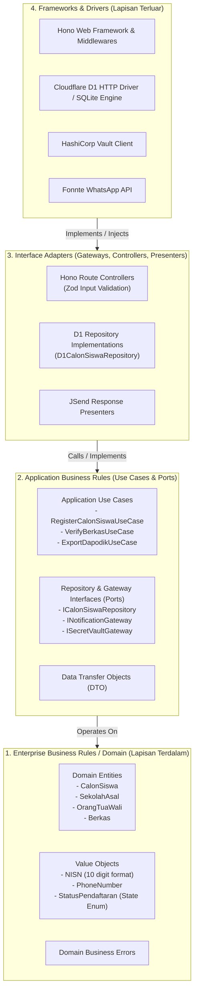
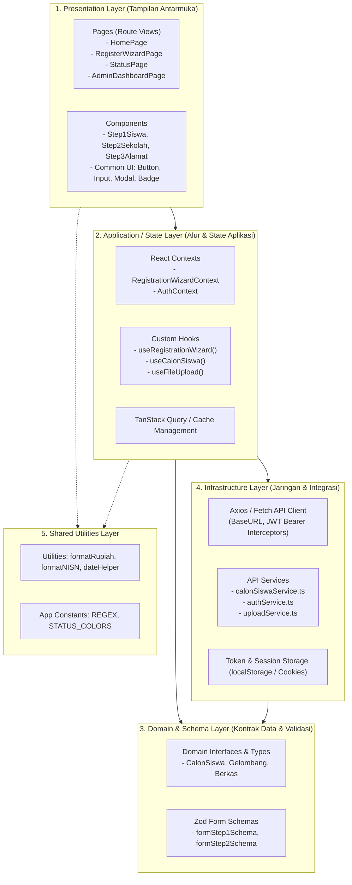
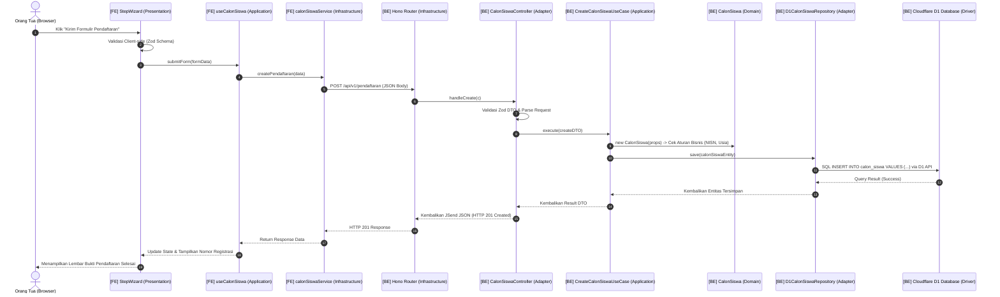

# Pola Arsitektur Perangkat Lunak (Software Architecture Patterns)
## Sistem Informasi Penerimaan Murid Baru (SIPMB) - SMP YAPIA Ciputat

Dokumen ini mendefinisikan standar arsitektur rekayasa perangkat lunak yang diterapkan pada sistem SIPMB SMP YAPIA:
1. **Monorepo Architecture**: Mengadopsi **pnpm Workspaces** (`apps/` dan `packages/`) dengan *single source of truth* melalui package bersama `@yapia/shared`.
2. **Backend**: Menerapkan **Clean Architecture** (Robert C. Martin / Onion / Ports & Adapters) menggunakan **Hono Framework** + **TypeScript** + **Cloudflare D1**.
3. **Frontend**: Menerapkan **Layered Architecture** menggunakan **React.js** + **Vite** + **TypeScript** + **Tailwind CSS**.

---

## 1. Backend: Clean Architecture (Hono + TypeScript)

### 1.1 Prinsip Aturan Ketergantungan (The Dependency Rule)
Prinsip fundamental Clean Architecture: *Ketergantungan kode hanya boleh mengarah ke dalam (inward dependency)*. Lapisan dalam sama sekali tidak boleh mengetahui keberadaan lapisan luar.



### 1.2 Penjelasan 4 Lapisan Clean Architecture Backend

| Lapisan | Direktori | Tanggung Jawab & Aturan |
|---|---|---|
| **1. Domain Layer** | `src/domain/` | **Entitas inti bisnis**. Tidak bergantung pada framework atau library apapun (kecuali pure standard TS). Berisi model `CalonSiswa`, `Value Objects` (misal: validasi ketat format NISN 10 digit, nomor telepon Indonesia), dan *business invariant rules*. |
| **2. Application Layer** | `src/application/` | **Logika alur kerja aplikasi (Use Cases)**. Mengatur interaksi entitas untuk mencapai tujuan pengguna (contoh: mendaftar calon siswa, mengubah status berkas). Mendefinisikan **Ports (Interfaces)** seperti `ICalonSiswaRepository`, `INotificationGateway`, tanpa mengetahui database apa yang dipakai. |
| **3. Interface Adapters** | `src/interface-adapters/` | **Jembatan penerjemah**. Mengubah data dari format luar ke format Use Case. Berisi `Controllers` (menerima HTTP request Hono, validasi Zod DTO), `Presenters` (membungkus respon format standar JSend), dan `Repositories` konkret (mengimplementasikan Port dengan query SQL Cloudflare D1). |
| **4. Frameworks & Drivers** | `src/infrastructure/` | **Detail teknis infrastruktur**. Konfigurasi instance Hono, routing URL, middleware (CORS, JWT Bearer guard), koneksi Cloudflare D1 HTTP client, Redis queue worker, dan client HashiCorp Vault. |

### 1.3 Struktur Folder Backend (`backend/`)

```text
backend/
├── src/
│   ├── domain/                         # Layer 1: Domain
│   │   ├── entities/
│   │   │   ├── CalonSiswa.ts
│   │   │   ├── User.ts
│   │   │   └── BerkasPendaftaran.ts
│   │   ├── value-objects/
│   │   │   ├── NISN.ts
│   │   │   └── StatusPendaftaran.ts
│   │   └── errors/
│   │       └── DomainError.ts
│   │
│   ├── application/                    # Layer 2: Use Cases & Ports
│   │   ├── dtos/
│   │   │   ├── CreateCalonSiswaDTO.ts
│   │   │   └── UpdateStatusDTO.ts
│   │   ├── ports/
│   │   │   ├── ICalonSiswaRepository.ts
│   │   │   ├── INotificationGateway.ts
│   │   │   └── ISecretVaultGateway.ts
│   │   └── use-cases/
│   │       ├── CreateCalonSiswaUseCase.ts
│   │       └── GetCalonSiswaDetailUseCase.ts
│   │
│   ├── interface-adapters/             # Layer 3: Adapters & Implementations
│   │   ├── controllers/
│   │   │   └── CalonSiswaController.ts
│   │   ├── presenters/
│   │   │   └── JSendPresenter.ts
│   │   └── repositories/
│   │       ├── D1CalonSiswaRepository.ts
│   │       ├── FonnteWhatsAppGateway.ts
│   │       └── HashiCorpVaultGateway.ts
│   │
│   └── infrastructure/                 # Layer 4: Frameworks & Drivers
│       ├── database/
│       │   └── d1Client.ts             # Cloudflare D1 HTTP REST / Native Binding
│       ├── http/
│       │   ├── middlewares/
│       │   │   ├── authMiddleware.ts
│       │   │   └── errorHandler.ts
│       │   └── routes/
│       │       └── calonSiswaRoutes.ts # Hono Routes
│       └── server.ts                   # Hono Application Entrypoint
```

---

## 2. Frontend: Layered Architecture (React.js + Vite)

### 2.1 Konsep Arsitektur Berlapis Frontend
Frontend mengadopsi pemisahan berbasis lapisan horizontal (*horizontal layered architecture*) untuk menjamin pemisahan tampilan (*UI*), alur state (*State & Logic*), model domain data (*Domain Types & Schemas*), dan integrasi jaringan (*API & Infrastructure*).



### 2.2 Penjelasan 5 Lapisan Frontend

| Lapisan | Direktori | Tanggung Jawab |
|---|---|---|
| **1. Presentation Layer** | `src/presentation/` | Seluruh komponen visual React. Terdiri dari `pages/` (halaman berdasarkan rute), `components/` (komponen atomik UI dan form wizard per tahap pendaftaran), dan `layouts/` (AppLayout, DashboardLayout). **Tidak melakukan panggilan HTTP langsung**. |
| **2. Application / State Layer** | `src/application/` | Pengelolaan status data, navigasi antar wizard, dan *side-effects*. Menggunakan React Context dan Custom Hooks (`useRegistrationWizard`, `useAuth`). |
| **3. Domain & Schema Layer** | `src/domain/` | Definisi TypeScript interface entitas bisnis pendaftar dan skema validasi *client-side* menggunakan Zod yang identik dengan aturan backend. |
| **4. Infrastructure Layer** | `src/infrastructure/` | Konfigurasi HTTP client, penyisipan token JWT, dan API service (`calonSiswaService.ts`) untuk berkomunikasi dengan backend Hono. |
| **5. Shared Utilities** | `src/shared/` | Formatters (Rupiah, format tanggal Indonesia, masking NISN 10 digit) dan konstanta umum. |

### 2.3 Struktur Folder Frontend (`frontend/`)

```text
frontend/
├── src/
│   ├── presentation/                   # Layer 1: Visual UI
│   │   ├── components/
│   │   │   ├── common/
│   │   │   │   ├── Button.tsx
│   │   │   │   ├── InputField.tsx
│   │   │   │   └── Modal.tsx
│   │   │   └── wizard/
│   │   │       ├── Step1CalonSiswa.tsx
│   │   │       ├── Step2SekolahAsal.tsx
│   │   │       ├── Step3Alamat.tsx
│   │   │       ├── Step4OrangTua.tsx
│   │   │       └── Step5UploadBerkas.tsx
│   │   ├── layouts/
│   │   │   ├── MainLayout.tsx
│   │   │   └── DashboardLayout.tsx
│   │   └── pages/
│   │       ├── HomePage.tsx
│   │       ├── PendaftaranWizardPage.tsx
│   │       └── DashboardAdminPage.tsx
│   │
│   ├── application/                    # Layer 2: State & Hooks
│   │   ├── contexts/
│   │   │   ├── AuthContext.tsx
│   │   │   └── WizardContext.tsx
│   │   └── hooks/
│   │       ├── useAuth.ts
│   │       └── useCalonSiswa.ts
│   │
│   ├── domain/                         # Layer 3: Models & Validators
│   │   ├── models/
│   │   │   ├── CalonSiswaModel.ts
│   │   │   └── GelombangModel.ts
│   │   └── validators/
│   │       └── registrationStepSchemas.ts
│   │
│   ├── infrastructure/                 # Layer 4: API & Network
│   │   ├── api/
│   │   │   ├── apiClient.ts            # Fetch wrapper dengan interceptor
│   │   │   └── calonSiswaService.ts    # Endpoint callers
│   │   └── storage/
│   │       └── authStorage.ts
│   │
│   └── shared/                         # Layer 5: Utilities & Constants
│       ├── constants/
│       │   └── statusConstants.ts
│       └── utils/
│           ├── currencyFormatter.ts
│           └── dateFormatter.ts
```

---

## 3. Alur Interaksi End-to-End (Data Flow Trace)

Berikut adalah diagram alur ketika orang tua mengisi formulir pendaftaran di Frontend hingga tersimpan di Cloudflare D1 melalui Clean Architecture di Backend:



---

## 4. Struktur Monorepo (pnpm Workspaces)

Proyek dikelola sebagai **Monorepo** untuk menyederhanakan siklus pengembangan, memastikan konsistensi tipe data, dan mempermudah orkestrasi build:

```text
smp-yapia-ciputat/
├── package.json                        # Root workspace configuration
├── pnpm-workspace.yaml                 # pnpm workspace definition (apps/* & packages/*)
├── tsconfig.base.json                  # Root TypeScript configuration
│
├── apps/
│   ├── backend/                        # @yapia/backend (Clean Architecture Hono API)
│   └── frontend/                       # @yapia/frontend (Layered Architecture React.js)
│
├── packages/
│   └── shared/                         # @yapia/shared (Shared Single Source of Truth)
│       ├── package.json
│       └── src/
│           ├── constants/              # USER_ROLES, STATUS_PENDAFTARAN, JENIS_BERKAS
│           ├── types/                  # UserDTO, CalonSiswaDTO, ApiResponse<T>
│           └── schemas/                # Zod schemas (createCalonSiswaSchema, loginSchema)
│
├── deploy/                             # Docker compose, cloudflared, vault, d1 schema
└── docs/                               # Dokumentasi teknis & spesifikasi sistem
```

### Keunggulan `@yapia/shared` di Monorepo:
1. **Single Source of Truth**: Aturan validasi (skema Zod) didefinisikan satu kali di `@yapia/shared`. Baik Backend (`@hono/zod-validator`) maupun Frontend (React form validation) menggunakan skema yang sama persis.
2. **Type Safety End-to-End**: Setiap perubahan struktur DTO di backend langsung terdeteksi oleh TypeScript di frontend saat kompilasi.
3. **Eksekusi Skrip Terpusat**:
   * `pnpm dev`: Menjalankan backend dan frontend secara bersamaan.
   * `pnpm dev:backend`: Hanya menjalankan backend Hono.
   * `pnpm dev:frontend`: Hanya menjalankan frontend React.js.
   * `pnpm build`: Membangun seluruh aplikasi dan paket secara rekursif.
