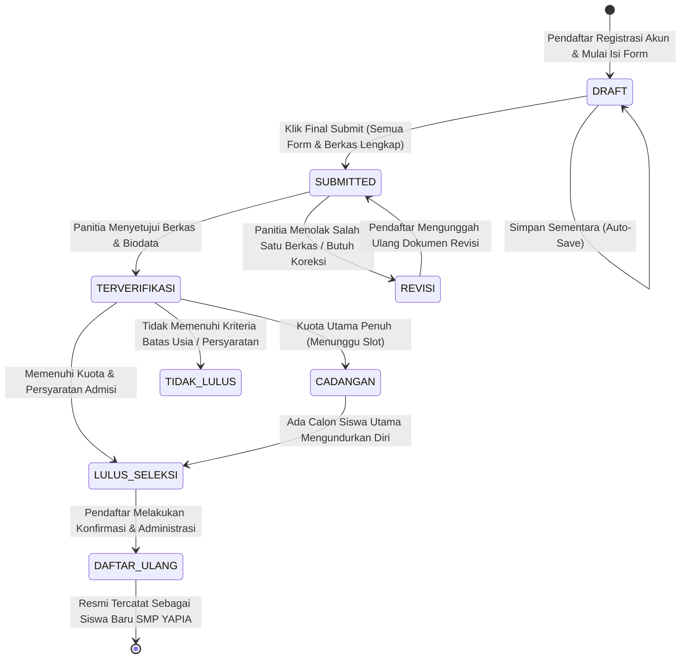
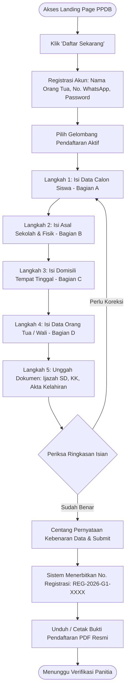
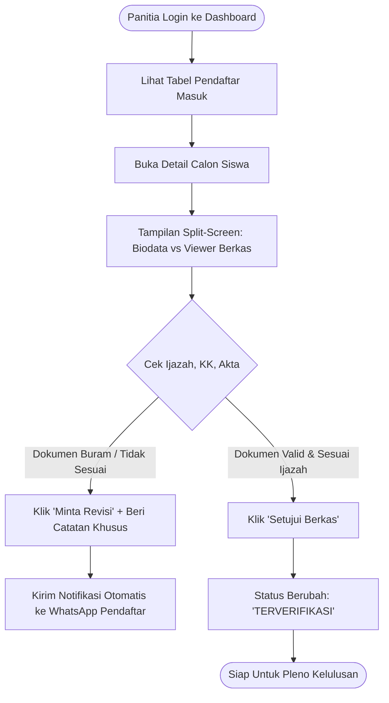

# User Flow & UI/UX Design Specification
## Sistem Informasi Penerimaan Murid Baru (SIPMB)
### SMP YAPIA Ciputat

---

| Informasi Dokumen | Keterangan |
|---|---|
| **Dokumen** | Spesifikasi Alur Pengguna & Desain Antarmuka |
| **Versi** | 1.0.0 |
| **Fokus Desain** | Mobile-First UI/UX & Responsive Desktop Back-Office |
| **Penulis** | Tim UI/UX Designer & Frontend Architect |

---

## 1. Diagram Status Pendaftaran (Application Lifecycle State Machine)

Setiap pendaftaran calon siswa melalui tahapan status yang terstruktur dan terdokumentasi dengan riwayat verifikasi:

---

## 2. Alur Pengguna Utama (User Journey Flowcharts)

### 2.1 Alur Calon Siswa / Orang Tua (Pendaftar Online)

---

### 2.2 Alur Panitia PPDB (Verifikasi & Helpdesk Onsite)

---

## 3. Spesifikasi Formulir Multi-Langkah (Multi-Step Form Wizard)

Formulir dirancang dalam bentuk antarmuka multi-langkah interaktif (*wizard*) dengan indikator progres di bagian atas. Struktur langkah merefleksikan 100% formulir pendaftaran fisik resmi SMP YAPIA:

### Langkah 1: Keterangan Calon Siswa (Formulir Bagian A)
- **Komponen**:
  1. *Nama Lengkap*: Input teks kapital otomatis, placeholder: "Contoh: ALKA ALHABSY" (Keterangan: Wajib sama persis dengan ijazah SD).
  2. *Tempat Lahir*: Input teks kota/kabupaten, placeholder: "Contoh: Jakarta".
  3. *Tanggal Lahir*: Datepicker dengan seleksi cepat Tahun, Bulan, Tanggal. Ditampilkan badge otomatis kalkulasi umur: *"Usia saat ini: 13 Tahun 10 Bulan"*.
  4. *Agama*: Radio Button group mendatar:
     - `[•] Islam` `[ ] Katolik` `[ ] Protestan` `[ ] Budha` `[ ] Hindu` `[ ] Lainnya`
  5. *Jenis Kelamin*: Segmented control button:
     - `[• Laki-Laki]` `[ Perempuan ]`
  6. *Nomor Handphone (WhatsApp)*: Input nomor telepon dengan format kotak digit angka (awalan `+62` atau `08...`).

### Langkah 2: Keterangan Pendidikan Sebelumnya & Data Fisik (Formulir Bagian B)
- **Komponen**:
  1. *Nama Sekolah Asal*: Input teks dengan saran autocomplete SD/MI terdaftar di wilayah Tangsel dan sekitarnya (Contoh: "SD Negeri Pondok Cabe Ilir 02").
  2. *Alamat Sekolah Asal*: Textarea alamat lengkap sekolah asal.
  3. *NISN*: Input khusus 10 kotak digit angka dengan validasi langsung ke format baku NISN Kemendikbud.
  4. *Data Fisik & Kesehatan*:
     - *Berat Badan*: Input angka numerik dengan suffix satuan `Kg` (Contoh: `45`).
     - *Tinggi Badan*: Input angka numerik dengan suffix satuan `Cm` (Contoh: `145`).
     - *Golongan Darah*: Radio button pilihan: `A` `B` `AB` `O` `Lainnya`.

### Langkah 3: Keterangan Tempat Tinggal (Formulir Bagian C)
- **Komponen**:
  1. *Alamat Tempat Tinggal*: Input teks nama jalan / gang / komplek (Contoh: "Jl. Talas II").
  2. *Detail Blok/RT/RW*:
     - *RT*: Input 2 digit angka (Contoh: `06`).
     - *RW*: Input 2 digit angka (Contoh: `01`).
     - *Nomor Rumah*: Input teks pendek (Contoh: `19`).
  3. *Kelurahan & Kecamatan*: Input teks atau dropdown wilayah Tangsel (Contoh Kel: `Pondok Cabe Ilir`, Kec: `Pamulang`).
  4. *Kode Pos*: Input tepat 5 digit angka (Contoh: `15418`).
  5. *No. Telepon Rumah*: Input nomor telepon rumah opsional.
  6. *Tinggal Dengan*: Radio selection:
     - `[•] Orang Tua` `[ ] Wali` `[ ] Asrama` `[ ] Lainnya`
     *(Jika memilih "Wali", maka tab data wali pada langkah berikutnya otomatis menjadi wajib diisi).*

### Langkah 4: Keterangan Orang Tua & Wali (Formulir Bagian D)
- **Komponen**: Menggunakan sistem Tab atau Accordion:
  - **Tab Ayah (Sesuai Ijazah)**:
    - Nama Lengkap Ayah
    - Pendidikan Terakhir: Dropdown (`SD`, `SMP`, `SMA/SMK`, `D1-D3`, `S1`, `S2`, `S3`, `Tidak Tamat SD`)
    - Tahun Lahir: Input 4 kotak digit (Contoh: `1980`)
    - Pekerjaan: Pilihan terstruktur / input teks (Contoh: "Karyawan Swasta")
    - Penghasilan Bulanan: Pilihan rentang gaji atau input nominal (Contoh: `Rp 3.500.000`)
  - **Tab Ibu (Sesuai Ijazah)**:
    - Nama Lengkap Ibu (Contoh: "Tria")
    - Pendidikan Terakhir (Contoh: "SMP")
    - Tahun Lahir (Contoh: `1984`)
    - Pekerjaan (Contoh: "Ibu Rumah Tangga")
    - Penghasilan Bulanan
  - **Tab Wali (Opsional / Kondisional)**:
    - Terbuka dan wajib diisi jika pada Bagian C opsi tinggal bersama adalah `Wali`.
    - Dilengkapi isian Alamat Lengkap Wali (RT, RW, Kelurahan, Kecamatan, No HP).

### Langkah 5: Unggah Dokumen & Konfirmasi Final
- **Komponen Unggah File**:
  - Tiga kartu unggah berkas wajib:
    1. **Ijazah SD / Surat Keterangan Lulus (SKL)** `[Wajib]`
    2. **Kartu Keluarga (KK)** `[Wajib]`
    3. **Akta Kelahiran (Akte)** `[Wajib]`
    4. **Pas Foto Calon Siswa (Ukuran 3x4)** `[Disarankan]`
  - Area seret & lepas (*Drag & Drop*) file atau tombol 'Buka Kamera / Galeri Ponsel'.
  - Pratinjau langsung thumbnail gambar / PDF viewer modal.
- **Pernyataan Persetujuan**:
  - Kotak centang persetujuan kebenaran data:
    *"Saya menyatakan bahwa seluruh data yang diisikan adalah benar dan sesuai dengan dokumen asli yang sah. Apabila di kemudian hari ditemukan ketidakbenaran data, saya bersedia menerima sanksi pembatalan penerimaan sesuai ketentuan SMP YAPIA Ciputat."*
  - Tombol aksi: `[Kirim Pendaftaran (Final Submit)]`

---

## 4. Spesifikasi Bukti Pendaftaran Resmi (PDF Print-Out)

Dokumen PDF yang dihasilkan sistem ketika pendaftaran disubmit mereplikasi dokumen fisik resmi sekolah:
1. **Header Kop Surat**:
   - Logo SMP YAPIA Ciputat di sudut kiri atas.
   - Teks Heading:
     - `YAYASAN PENDIDIKAN ISLAM AL-IKHLAS (YAPIA)`
     - `SEKOLAH MENENGAH PERTAMA (SMP) YAPIA CIPUTAT`
     - `TANDA BUKTI PENDAFTARAN PESERTA DIDIK BARU`
     - `TAHUN AJARAN 2026/2027`
2. **Badge Informasi Registrasi**:
   - Nomor Pendaftaran (misal: `REG-2026-G1-0003`).
   - Tanggal & Waktu Submit.
   - Status: `TERVERIFIKASI`.
3. **QR Code Keaslian Dokumen**:
   - Diletakkan di pojok kanan atas. Memuat URL verifikasi digital resmi sekolah.
4. **Isi Ringkasan Data Siswa**:
   - Tabel rapi memuat seluruh data Bagian A, B, C, dan D.
5. **Kolom Penandatanganan**:
   - Kolom 1: a.n Ketua Panitia PPDB / Penerima Pendaftaran.
   - Kolom 2: Mengetahui, Orang Tua / Wali.
   - Kolom 3: Pendaftar / Calon Siswa.
